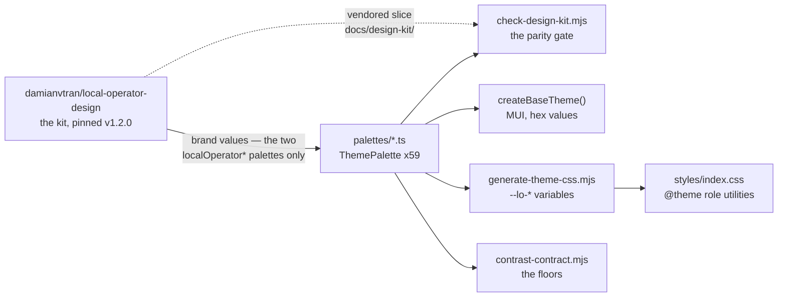

# Branding and design system

The visual and verbal system for the Local Operator desktop app, and the rules
that keep it consistent as it changes.

This is the app-side companion to the design kit at
`damianvtran/local-operator-design` — the home of record for the brand — of
which this repository vendors a pinned slice under
[`docs/design-kit/`](./design-kit/README.md). Where the two disagree about the
brand, the kit wins; where they disagree about *how a desktop app should
behave*, this file wins, because a tool read for hours at arm's length is not a
page read once.

**Read this before changing any visual surface.** The parts of this system that
are enforceable are enforced by `pnpm check-themes`; the rest is here because a
rule nobody wrote down gets re-litigated every quarter and re-broken every
release.

---

## 0. The one sentence

> The audience has used a chat assistant. They have not used a build tool.

Every rule below follows from that. The app runs agents that write and execute
code on your own machine — genuinely technical machinery — for people who
describe their problem in a sentence. The interface's job is to make the
machinery *legible* without making it the subject.

The failure mode this system exists to prevent is an app that looks like a
terminal wearing a GUI: dense chrome, monospace everywhere, every internal step
of the agent's reasoning shown at equal weight to the answer.

---

## 1. Architecture: where colour comes from

One source, two consumers. Do not add a third.

The kit is **upstream** of the brand values, not a parallel source. It feeds
only the two `localOperator*` palettes — the other fifty-seven are
community-owned identities the kit never authors — and it arrives here as the
pinned slice under `docs/design-kit/`. "One source, two consumers. Do not add a
third." still stands for the app's internal pipeline: `palettes/*.ts` remains
the single source the app renders from, and the parity gate is an additional
*consumer* of that source.

- **`src/renderer/src/shared/themes/palettes/*.ts`** — the single source of
  truth. Fifty-nine `ThemePalette` objects, 38 roles each, every value a literal
  string.
- **MUI** consumes them as hex, because roughly 299 `alpha()` call sites need a
  real colour and cannot take a `var()`. This half shrinks as the port
  continues.
- **Tailwind** consumes generated CSS variables. `pnpm gen-themes` writes
  `styles/themes.generated.css`; never hand-edit it.
- **`pnpm check-themes`** verifies the generated file is current and that every
  palette clears the floors in § 3.
- **The kit is upstream, pinned in [`docs/design-kit/`](./design-kit/README.md)** —
  a locked slice of `app-family.json`, `divergences.json` and `LICENSE`.
  `scripts/check-design-kit.mjs`, the third step of `pnpm check-themes`, proves
  the slice equals the kit at the pinned ref and that both `localOperator*`
  palettes re-derive to it. Pins move only by a deliberate pin-bump PR recording
  its reason, and a sanctioned departure from the kit is recorded in the kit's
  `divergences.json` before it lands here — never edited into the slice.

The theme provider sets `document.documentElement.dataset.theme`. That attribute
is what every Tailwind role utility resolves against — without it, the ported
half of the app renders unthemed.

### Why roles rather than colours

Fifty-nine themes are user-selectable, and a "Dracula" theme is a promise to a
user.
Overriding community palettes with brand green would break exactly the users who
chose them. So the brand ports as **roles with contrast floors**, not as values:
the two `localOperator*` palettes *are* the brand, and the other fifty-seven
only have to satisfy the contract while keeping their own identity.

A component never names a colour. It names a role — `bg-surface`,
`text-ink-muted`, `border-control` — and the theme decides what that is.

---

## 2. Colour

**Settings navigation is a local exception to persistent row selection.** Its
current and inactive destinations reveal the same `surface` ground at rest and
share `rowHover` under the pointer. The current page uses `ink`, semibold text,
an accent glyph and a small decorative accent dot in the existing gutter;
`aria-current="page"` conveys that state nonvisually. The dot remains in the
collapsed icon rail and takes no layout space. This keeps the requested
continuous, borderless surface without weakening chat's selected-row treatment.

### The four grounds

`canvas` (page) → `surface` (cards, panels, inputs) → `elevated` (menus,
popovers, tooltips, hovered rows), plus `sunken` (wells, tracks, code grounds)
recessed below canvas.

#### The ground floors, and the ladder above them

A page ground is not a taste call. It is the surface the transcript is read on
for hours, so it has a floor rather than a band with discretion:

| Rule | Value |
|---|---|
| dark `canvas` | **hard floor L\* 12**, **hard ceiling L\* 22**, target band 12–20 — three palettes sit above the target inside the ceiling, at `catppuccinFrappe` 21.99, `everforest` 21.65, `nord` 21.60 |
| light `canvas` | **ceiling L\* 94** |
| dark `elevated` | **ceiling L\* 30** |
| light `sunken` | **floor L\* 80** |
| `canvas` → `surface` | **+2.5 to +5.0 `L*`** |
| `surface` → `elevated` | **+2.5 to +6.0 `L*`** |
| `canvas` → `sunken` (down) | **1.5 to 6.0 `L*`** |

Why 12 and not 8: at canvas 12 / surface 17 / elevated 24 the three ink weights
solve to L\* 78 / 74 / 71 with every floor and every step intact, and below that
the ladder and the ink steps stop fitting together — measured, 8 of the 41 dark
palettes were below L\* 5, `obsidian` at 2.51 the lowest. 12 is one rung above
GitHub Dark's `#0D1117` (4.95) and exactly VS Code Dark+'s `#1E1E1E`, i.e.
deliberately above GitHub's default. Why the maximums as well: an unbounded top
step is what makes the ink budget unaffordable — at `elevated` L\* 34 an `ink-dim`
at 5:1 needs L\* 85, and the ink/hover distinction disappears into the top of the
ramp — and the light cap is the same arithmetic from the other end (`elevated` at
L\* 100 is the end of sRGB's ramp, and the minimum spread is 2.5 + 2.5).

**Lifting a ramp moves lightness only.** A ground is re-solved by holding its own
`a` and `b` at a new `L*`, so a theme keeps its hue and its chroma class and
changes only how light it is; chroma is scaled only where sRGB forces it. The cost
is real and recorded rather than argued away: the four palettes whose upstream
identity *is* near-black — `obsidian`, `tron`, `matrix`, `dune` — lose the black
and keep the family. `obsidian` is the clearest case: zinc 950 becomes
zinc-900-ish monochrome at L\* 12, with its h290 blue lean and no manufactured
chroma.

**The grounds never move alone.** Raising a dark ground raises the luminance every
ink is measured against, so an ink that cleared its floor can fail it after:
`localOperatorDark`'s `ink-dim` measures 4.61:1 on `elevated` as shipped, 3.86:1 on
that same ink once the ground rises, and 5.02:1 only because the ink is re-authored
with it. `border-control` and each semantic `-border` are the same story from the
other side — a lifted `elevated` costs the edge its contrast, and left where they
stood they fail 3:1 on it in eight palettes. So the ramp, the inks and the edges
land in one change, and a change that lifts grounds without them makes the reading
worse rather than better.

**One more ground behaves like one, for text's sake.** `accent-wash` and the two row-state roles are already required roles, and all three
now carry the ink floors (§ 3):
they are where a keycap on a selected row, a chip label and a reading button on its
own hover are actually read, and neither was measured before the legibility pass —
which is how `ink-dim` came to sit at 3.91:1 on a selected row in `cyberpunk` with
every gate green.

**The user message block's fill is a role of its own.** `message-surface` is the
block's own surface — not a fifth ground and not a state: the fill **is** the block's
boundary (the border D10 retired was "the third and loudest mark on the quietest object
in the transcript"), so it carries a findability floor of its own — **ΔE00 4.0 off the
canvas** it is drawn on, with a **≥ 2.5 `L*`** step — authored as the first clearing step along
`surface` toward `elevated`, or `surface` itself where that already clears the floor. It
is not `surface` because that role is the app's shared panel ground, bounded by the
ladder (2.5–5.0 `L*`) and moving every card and panel with it: on the palettes where its
step lands low (sage 2.05, `catppuccinMacchiato` 2.08, `oneLight` 2.10 ΔE00) the block's
only boundary was a fill a reader cannot see — the operator's report that "the contrast
between the user message background and the chat background is quite poor on some
themes". 4.0 sits at or below the step the same column's composer carries
(`elevated`/`canvas`, 4.17 at its fleet worst) on all but one of the 59 palettes -
`catppuccinFrappe`'s block steps 4.26 against its composer's 4.23, 0.03 over and
below any perceptual step - so the block reads as the quietest object on the
screen, that single exception stated rather than rounded away.

**The media tile's fill is a role of its own.** `media-surface` is the borderless
condensed strip tile's ground — not a fifth ground and not a state: the tile draws
**no edge at rest** (the ring went at the operator's ask; it returns only on hover
and keyboard focus, the states in which the tile is a control), so the fill **is**
the tile's extent — and the shared `sunken` well could not carry it, measuring below
ΔE00 4.0 off the canvas on **55 of the 59** palettes and bottoming at **2.00**
(`iceberg`, `neonNoir`; the 56th mover, `synth`, clears ΔE00 9.03 and moves for the
lightness half alone), which is the tile a page-toned picture had. It carries its
own findability floor — **ΔE00 4.0 off the canvas** it is drawn on, with a **≥ 2.5
`L*`** step in magnitude — authored as the first clearing step along `canvas` →
`sunken` continued **away from the canvas** (the palette's own recessed ramp), or
`sunken` itself where that already clears the floor (three palettes: `ayuMirage`,
`duskfox`, `forest`). The direction is the object: a slot is a well, so its fill
deepens away from canvas; stepping up the ladder would cross `canvas` and make it a
raised plate. 4.0 is the floor for the smallest mark the eye must find, and at a
picture that fills the slot the well's whole visible extent IS that small — a ~1px
ring at the picture's edge and corners — which is why the 1px-mark floor is the
right one rather than the field floor. The returning edge (`border-control`, ≥ 3:1
on every ground — the OUTER pairing, the side the silhouette is read against;
against the fill it measures below 3:1 on ten light palettes and is deliberately
not asserted, see the role's doc) stays the stronger, state-only cue.

There are **two state roles, and each is a rung of the panel's own ladder**: `rowHover`,
the fill of the row under the pointer, and `rowSelected`, the fill of the row the
reader is currently ON. Both are **steps of the panel's own colour, at the panel's own
hue** — the operator's ask, and the correction of the rule that preceded it: the roles
used to be tints of the palette's own `accent` hue, which is more than 45° off the panel
it is painted on in **25 of the 59** palettes (`kanagawaLotus` 176°, `solarizedLight`
168°, `arcade` 158°), so a fill could read as a different colour from the thing it was a
state of — a green plane with a green leading bar on `localOperatorDark`'s warm brown
panel.

**The brightening is the carrier and the colour is a whisper riding on it**, and the
whisper comes from the backdrop, which is the only source that cannot be off-colour: the
hover carries **60% of the panel's cast** (floored at C* 2.5, capped at the panel's own),
and the selection carries **the panel's cast plus up to 4** (floored at C* 5.0, capped at
24). Both take the `L*` step the three ink floors allow, capped at 5.0 `L*` for the
selection; the hover spends **65% of the selection's step**, walked down until the pair's
rank clears 1.0 `L*`. Measured across the fleet: the hover's step goes from a median 1.61
to 3.09 on dark and 1.60 to 3.25 on light, and the selection stays at the cap (4.70 →
4.76 dark, 4.87 → 5.00 light) because it was already spending it. That is the operator's
clause 2: the shipped hover spent **30%** of the `L*` it was allowed.

**Why the axis had to change, in one measurement.** The band the roles were authored to —
ΔE00 4.0 or better off `surface` — **cannot be bought on lightness**: holding the hue and
the chroma at the panel's own and taking the largest step the inks allow, it reaches 4.0
on only **40 of the 59** palettes and bottoms at 2.08. The shipped rule met its own band by
leaving the panel's colour family, which is the operator's report; that band is therefore
**withdrawn rather than lowered**, and what replaces it is the file's own field floor
(ΔE00 2.0 off `surface`, so a fill literally indistinguishable from its panel still fails)
plus the two step floors and the two rank floors below. The trade is stated: the achieved
band's median falls from 6.50 to 3.81 on the hover and from 10.95 to 4.26 on the selection.

**The fill now ranks the pair, and that is the change of contract.** `rowSelected` used to
be the SUPPORTING role: what said "you are here" was a **2px `accent` bar on the row's
leading edge** plus `font-medium`, so the fill only had to be findable. The **bar is
removed** — the operator asked for it, and its square overlay painted over `rowStyle`'s
`rounded-md`, which is what squared the row's leading edge and what "restore the left
rounding" was about (the 6px radius never moved). So the fill carries the ranking: **at
least 1.0 `L*`** beyond the hover and **at least 2.0 `C*`** of cast more than it, with
`font-medium` as the non-colour half. The `C*` rank is the axis that costs nothing — `L*`
determines relative luminance, so contrast ratios are blind to chroma — and the fleet's
chroma rank now runs **2.50–11.46** where it was often *inverted* (the hover desaturating
while the selection did not). Measured across the 59: the pair runs 2.15–7.01 ΔE00 (median
6.01) and ranks 0.94–2.03 `L*` (median 1.62). The two POPUP bars (`slash-commands`,
`at-picker`) **stay**: their row is the one Enter will apply, in a transient popup where
the keyboard has no other mark.

**Two collision floors are withdrawn with the bar, and the risk is stated.** A fill that
is the panel's own colour one step up **is** a rung of the ladder it sits on, so
`rowSelected` and `rowHover` are no longer held ΔE00 1.0 clear of `canvas`, `elevated` and
`sunken` (measured: 7 of the 59 breach it under the rule, where the values it replaces
escaped only by being rotated to another hue). A selected row can therefore be the same
colour as a dialog's ground or an input well; they are never adjacent inside one list —
this panel's own `elevated` use is the `· lopdev` cap and the `⋯` button, both text-sized
rather than full-width rows — and the `sunken`-versus-row pair in § 3 is withdrawn with it.

**Seven palettes are a CLASS and seven rows are LEDGERS, and no floor is widened.** A
palette whose **panel** carries less than C* 2.0 has no cast of its own for a state to be
a state *of*, so it takes the `accent`'s hue and the rule's absolute cast floors, and the
wash proximity is not asserted — seven members (`githubLight`, `gruvbox`,
`highContrastLight`, `iceberg`, `linen`, `oneLight`, `tokyoNightDay`), routed by
derivation rather than by name (`ROW_STATE_NEUTRAL_PANEL`), and none of them uses the
class's relaxed pair floor (their pairs run 2.15–3.71). The rule's own shortfalls are
carried as named, re-measured rows in `scripts/contrast-contract.mjs`: one geometry row
(`synth`, whose panel carries C* 26.83 against the rule's flat cap of 24, so its selection
sits at the cap) and six measured shortfalls, each naming the floor that refuses it —
three light-family hovers whose CIEDE2000 `S_l` term divides a legal step below the field
floor (`ayuLight` 1.95, `dune` 1.91, `rosePineDawn` 1.67), one pair the ink floors leave
no lightness room to rank (`catppuccinMacchiato`, 0.94 `L*`), and two washes
(`gruvboxLight` 1.44, `obsidian` 1.38). Every row fails the gate if it is no longer
needed, and a palette in the geometry position with no row fails it outright.

**No palette may spend a floor to buy a band.** The above is the whole of the trade: the
class and the seven ledger rows are the only named relaxations, each carrying its
measurement — see `docs/evidence/row-states-refined/README.md` for the frames and
`scripts/contrast-contract.mjs` for the numbers behind each bound.

A selection is a mark on a panel, not a hole in it: `sunken` is always recessed
and measures 3.75–14.94 from `surface`, which is a dark box rather than a
highlight, and it is the role 97 `*-sunken` utility occurrences across 66 files
under `src/renderer` depend on being deep (85 live class usages and 12 inside
prose, the palettes and the generated stylesheet excluded).

**There is no boundary on a current row, and that is a decision with a
measurement behind it.** An earlier round drew a 1px `outline-control` ring
beside the ground, and it is retired: `border-control` is § 2's *sole visual
boundary of an input, select, checkbox or outlined button* and a nav row is none
of those; no other role in the system carries a 3:1 structural floor; and the
ring rendered with the search field's own ink, height and radius one line below
the field itself, so the current row read as a filled input — worst on `iceberg`,
where a periwinkle ground inside a navy line reads as a disabled field. The
operator had already had that same boundary removed from the New chat row for the
read it produces. If a selection ever needs a third signal, that is a role this
contract does not have — add it there rather than borrowing one, which is the
rule § 1 states for every other missing value.

`rowSelected` and `rowHover` are not in `check-themes`' `GROUNDS` list, because that
list is the set a control is drawn on one of at a time and every ink and structural
border is measured against all of it; a row still sits INSIDE a `surface` panel. The
contract asserts what the row actually depends on instead: each role against
`surface` at its own band floor of ΔE00 4.0 (so the mark is visible, and so that its
`L*` step runs the right way), against `canvas`, `surface` and `sunken` at the
collision floor of ΔE00 1.0, and `ink` / `ink-muted` / `ink-dim` on both fills at
their usual floors. It does not assert `border-control` on the row: there is no
boundary on it (above).

**The rule a porting author follows**, so a new palette can be derived rather
than tuned: take the `L*` step **first**, at the panel's own hue, in the direction
the mode runs — as far as the ink floors allow — and then buy only the shortfall
to the band's floor of **ΔE00 4.0** on the chroma axis at that same hue. Chroma
may pay a remainder; it may not pay the step. The constraints:

- targets **ΔE00 ≥ 4.0 from `surface`**,
- keeps every ink floor with at least **0.15 of headroom above it** — `ink` ≥
  7:1, `ink-muted` and `ink-dim` ≥ 4.5:1 on the row's own ground, and
  `ink-dim` is the one that usually binds, because the caps and the `· lopdev`
  binding inside a current row are drawn in it — and
- stays **ΔE00 ≥ 2.0 from `elevated` and from `sunken`** (the field floor § 3
  enforces; 2.2 is the target to aim past, being where the original band's
  separation was measured),
- carries the panel's own colour: chroma **at or above the panel's**, and at or
  below **the looser of 1.5x the panel's and the panel's + 4** — the asserted
  ceiling — with the peer round's tighter pair (**1.15x, or the panel's + 1.6**)
  as the target, and
- stays within **12 degrees of the panel's hue** (15 is the outer bound no value
  may exceed; 12 is the tighter of the two rounds' measurements, the point where
  a rotation stops reading as the panel's own colour and starts reading as one the
  theme does not have).

**The band is primary and has no exception.** The operator has reported the
current row twice — grey, then invisible beside a hovered neighbour — and ΔE00
≥ 4.0 from `surface` is what answers that, so no palette trades it away for a
tighter cast. The chroma ceiling is an asserted bound rather than a ledger: the
hover takes at most `ROW_HOVER_CHROMA_OUTER` (0.6) of the palette's `accent`
chroma and the selection at most `ROW_SELECTED_CHROMA_OUTER` (0.75), both capped
at C* 24, and no palette has needed an exemption from either since the roles were
authored — the thirteen ledger rows this section used to carry dissolved into
rules (see `palette-contract.ts`'s `rowSelected` doc for the reconciliation), and
`HIGHLIGHT_CONTINUITY_EXCEPTIONS` is gone with the role it measured.

Four of the twelve still carry a partly chroma-bought step — `dracula` 1.20x the
panel's chroma, `monokai` 1.66x, `obsidian` 1.90x and `iceberg` 3.31x — each
recorded at its own value in its palette. They clear the asserted floor, and they
are what a re-authoring should take next: `iceberg` is where the cost is visible,
because that panel is the least chromatic of the twelve (C* 1.57), so its step
reads as a lavender band rather than a darker row (design round 1, D4). Its
earlier justification — that its recessed ground capped the step — was wrong:
`sunken` sits ΔE00 3.75 from that `surface` and the row still clears it by 2.53.
Those multipliers are quoted against the RETIRED role's ledger and are historical:
the two state roles spend the palette's own `accent` hue at a bounded fraction of
its chroma, so what a reader should carry from this paragraph is the lesson — a
band bought with chroma alone does not answer the report — and not the ratios.

**Elevation is a lightness step, not a shadow.** There is exactly one shadow in
the system and it belongs only to objects that leave the flow: menu, dialog,
drawer, popover, tooltip, select. An in-flow card that needs to feel raised
takes the next ground, not a shadow. This is why the four grounds must be
mutually distinguishable, and why `check-themes` asserts it.

### The four inks

`ink` (primary) → `ink-muted` (secondary) → `ink-dim` (captions, metadata,
placeholders) → `ink-disabled`.

| Role | Register | Standard floor | This system's floor |
|---|---|---|---|
| `ink` | body, names, headings | 4.5:1 (AA) | **7:1 on all eight grounds; 8:1 on `canvas`** |
| `ink-muted` | secondary: descriptions, 13px rows, chip labels | 4.5:1 | **5.5:1** |
| `ink-dim` | captions, metadata, placeholders, keycaps, 11–13px | 4.5:1 | **5.0:1** |
| `ink-disabled` | disabled controls | exempt (SC 1.4.3) | no floor — **capped at 0.8 × `ink-dim`** |

The **eight measured grounds** are the four elevation steps plus the four that
carry text as a *state* or a surface: `accent-wash` (selection/hover tint,
callouts, chips, find-match), `rowSelected` (the selected row in the chat sidebar),
`rowHover` (the row under the pointer), and `message-surface`
(the user message block's own fill). SC 1.4.3 asks
4.5:1 of every ink and nothing more, and the reason this system asks more is that
4.5:1 at 11px is not 4.5:1 at 14px: a contrast ratio is luminance-only and says
nothing about stroke weight, size, or the thin-hairline register metadata is
printed in. Every type step here is normal text except `text-display` (28px) —
`text-title` is 20px and not bold at the role level — so 4.5:1 is the only
applicable standard floor, and the floors above are the system's own.

`ink` takes an extra 1:1 on `canvas` because `canvas` is the transcript — the one
surface in this app read for hours at arm's length.

`ink-disabled` is the only role exempt from a contrast floor, because a disabled
control that meets 4.5:1 does not read as disabled. It is not unconstrained,
though: it is the one role bounded from **above**, at **0.8 × `ink-dim` on every
ground**. Making the inks lighter threatens the disabled state from below, so the
relation is asserted rather than assumed, and because both inks sit on the same
side of every ground it reduces to a fact about the two of them.

The three weights are also a hierarchy, so the floors alone are not enough — three
inks each at their floor can be the same colour. `ΔE00(ink-muted, ink-dim) ≥ 8`
(the same floor this doc uses for a comment against the code beside it, because a
live chip beside an inert reading has to beat it) and `ΔE00(ink, ink-muted) ≥ 2.0`
are asserted too.

### The structure ink that is not in the ladder

`tokenCommand` is the fifth required ink and it is deliberately outside the
ladder above: it never carries prose. It is the composer's syntax highlight —
the slash word the app is about to RUN, the desktop twin of the TUI's
`$lo-signal` — so its job is to be distinct from the three inks it is read
against IN ONE LINE (`ink` for the instruction, `accent` for a live turn,
`success` for a roster name) rather than to sit at a step in a hierarchy. Floors
are per-palette and measured on the composer's own ground: at least 4.5:1 on
`surface` and on `elevated`, and at least **ΔE00 8 from `ink`, `accent` and
`success`**. `obsidian` is the one pinned exception — its `info` IS its `ink`, so
there the run is separated by the painted weight step alone.

Beside the ink, the run carries that weight step (`slash-run-bold`, a 0.5px
text stroke — one constant width at every raster, not a per-display band). It is
a STROKE and not a `font-weight` for a layout reason: the
mirror paints every glyph while the textarea's own text is transparent, so the
two layers have to wrap at the same character, and a real weight change moves
the advances — which wrapped the mirror earlier than the textarea and hid the
tail of the user's draft behind the mirror's own overflow (measured: 65 of 78
typed characters). Add a run ink here and give it the same treatment.

### The two lines — the distinction people get wrong

- **`hairline`** is decorative: section rules, table separators, list dividers.
  It carries no information and has no floor.
- **`border-control`** is structural: the sole visual boundary of an input,
  select, checkbox, or outlined button. Floor 3:1 on all four grounds.

Most palettes ship one border colour and use it for both jobs. That is how the
old light theme ended up bounding every input in the app at **1.25:1** — the
control's only edge, effectively invisible. If you are adding a boundary, ask
whether removing it entirely would lose information. If yes, it is structural
and must clear 3:1. If no, delete it rather than reaching for `hairline`.

**The panel rail is chrome (#872, #896).** The 44px column at the window's right
edge holds the right-slot doors - the four panel triggers since #872, and the asks
drawer's door since #896 - and it stands on the sidebar's rung: `surface`.
Its leading edge carries the same 1px `hairline` seam as the sidebar's inner
edge (`panel-edge.tsx`, § 2's panel section) and the tone step under it. The
seam was added on 2026-10-30 because the step alone did not read in light
themes; the paragraph here used to argue the absence, and what is still true of
that argument is its measurement, which is the reason the seam exists. The
ladder asserts these pairs at the 2.0 field floor, and
`REGION_SEPARATION_FLOOR` (4.0) in `scripts/contrast-contract.mjs` is the
stronger bar it sets for two full-height planes with no line between them.
Against the conversation's `canvas` with no pane the step measures ΔE00 2.05 at
the fleet's tightest (`sage`) to 6.76 (`radient`), median 2.94 (2.77
`localOperatorDark`, 2.32 `localOperatorLight`); against the slot's `elevated`
with a pane open 2.02 (`arcade`) to 6.62 (`gruvboxLight`), median 2.58 (3.29
dark, 2.50 light). Where a pane draws its own `surface` plane flush to the rail,
the two chrome planes meet with no step by design: the canvas Files list
scroller, the browser approvals dock, the canvas markdown viewer's root (via the
`display: contents` tab panel) and the html/pdf preview iframe grounds are all
`bg-surface`. `scripts/pane-slot-ground.test.mjs` pins the rail's root to its
ground with no border, divide or shadow utility on it - the seam is a child
element, so a rule cannot come back as a second way of drawing the edge. The lit
item is the sidebar's selected-row pair, `rowSelected`
ground and `accent` ink, plus a 2px `accent` bar flush with the rail's leading
edge; the bar is there because an icon-only item has no weight to change (the
sidebar's non-colour channel is `font-medium`), so it is the one mark that
survives a theme whose `rowSelected` sits close to `surface`. No new role:
`check-themes` carries the pairs as the `panel rail ...` rows of
`scripts/contrast-contract.mjs`.

**The composer is an object that leaves the flow.** Its ground is `elevated` on
`canvas` (+4.89 L\* at worst, +6.64 at the median across the 59 palettes) and it
draws **no border at rest**: the step is what separates it, and the accent ring
is reserved for `:focus-visible`. Where it sits over scrolled content, the
transcript gets a 24px fade mask to `canvas` at the pane's top edge and a
matching mask above the composer — not the shared shadow, which this section
reserves for objects that float (menus, popovers, dialogs).

Why the step rather than an edge, recorded because the two look interchangeable:
the five reference composers at this size get their separation from a lightness
step, and this app's own `border-control` is the accent on the brand palette, so
a bordered composer was the loudest thing on the screen at rest — a ring around
an empty box, while the transcript sat at `canvas` with nothing pointing at it.
The accent is spent on what the user acts on (the send control's fill) and on
focus, not on the frame of an empty field.

### Panels: one seam, edge-to-edge, fading at the top

A full-height panel is a region that owns a ground at the window's edge — the app
sidebar, the rail, the right pane slot. It is not a card, an input, a menu or a
popover.

- **A full-height panel draws one seam, and still no border.** The tone step is
  the panel's ground against its neighbour's; the seam is one 1px `hairline` at
  75% along the edge the two share, painted by `panel-edge.tsx`. The tone step
  alone is not enough between two full-height planes: `canvas` to `surface`
  measures ΔE00 2.32 in `localOperatorLight` and 2.77 in `localOperatorDark`, a
  ladder step sized for a small field. The seam is the app's decorative line at
  three quarters strength — quieter than a section rule, and a real edge where
  there was none. It is a positioned 1px element, not a `border`, because a
  border takes a pixel from the panel and a panel is a scroll container; it is
  full height (mounted on the full-height box that paints the ground, never on a
  `panel-top-pad` content box, whose child would start at the pad) and paints
  above sticky rows, so it cannot repeat the mid-height seam that made the old
  border look broken. `border-control` is still the edge of a control, never of
  a panel. Two marks are allowed to paint over it, because they are state rather
  than decoration: the resize handle's 2px hover/drag line and the lit rail
  item's 2px `accent` bar. The seam is asserted in § 3 and measured at ΔE00 2.92
  or better from its own ground (`elevated`) and 2.29 or better from the plane it
  faces (`gruvbox`'s rail against an open pane), across all fifty-nine palettes.
  That assertion is an opaque-theme guarantee: under window glass the ground is
  a translucent `surface` composited over the desktop, which the opaque-hex
  contract does not measure.
  - **Where it is drawn:** the shell's sidebar column along its inner edge, the
    shell's rail host along the rail's inner edge, and each right-slot pane
    along the edge it shares with the conversation. A panel that sits inside a
    route rather than against the window edge (a card, an inspector inside a
    page) has no seam: the tone step is the whole boundary there, because it is
    one object on a page, not a column of the window.
  - **The sidebar's seam is the shell column's edge, on every route.** It marks
    where the app sidebar ends, so on a route whose own leading column is also
    `surface` — the Settings nav, the Agents roster — it is the only boundary
    between the two chrome planes, and those two keep the flat join *under* the
    seam. The route column's own edge to its content keeps the tone step alone;
    a seam inside a route's own layout is out of this change's scope.
  - **The seam is placed logically.** `start-0`/`end-0` keep it on the side
    facing the content in RTL; the class is pinned in
    `scripts/pane-slot-ground.test.mjs`, but no rendered RTL frame was taken in
    this change.
- **Full-height panels extend through the titlebar strip; no top inset on the
  panel; the scroll region clips and fades under it.** A panel that owns its
  ground (the app sidebar, a route's leading rail, the Library filter rail, the
  asset-details dock, the right-slot panes and canvas tabs, the panel rail,
  Team Bridge's columns) starts at y0 and paints its own ground through the
  traffic lights' band. Its first content row is padded by
  `--panel-top-pad` — the shell publishes `var(--chrome-strip-h)` on the
  content column for every route, so no route needs its own inset and none may
  compute one.
  - The mechanism is two utilities in `styles/index.css`, defined once:
    `panel-flush` on a route root that owns the whole window height (it cancels
    the shell's ordinary-content pad) and `panel-top-pad` on a full-height
    panel column (it pushes the column's first row below the strip while the
    panel's ground keeps y0). A simple page that is not a panel needs neither:
    the shell pads it once on `<main>`.
  - The titlebar lane is a single transparent overlay for every route. It
    reserves no height and paints no ground; there is no route opt-in, and
    no gradient mirror of the columns. Only the drag surface and
    `data-slot-edge` remain on it.
  - **A scroll region must clip at the panel's content edge, so its pad sits
    outside the scroller.** A scroll container's own `padding-top` clips at
    its padding box, which lets scrolled text paint through the strip; the
    panel pads, the scroller begins at y32, and the existing top fade
    (`data-lo-sidebar-edge-cues`) stays on the scroller. A file name scrolling
    in the Library dock disappears at the dock's content edge, not at y0. When
    the panel's ROOT is the scroller, `panel-scroll` states the same contract
    as a margin plus the matching height.
  - The element that wears `panel-top-pad` is the element that paints the
    panel's ground. A padded wrapper that owns no ground is the inset band this
    rule exists to forbid, not a clearance: the padding is invisible only when
    it sits inside the surface it belongs to. A content column nested inside a
    grounded, `panel-flush` ancestor needs no ground of its own — and must not
    take one, which would put a second tone step inside a single panel.
- **Chrome controls are borderless too.** A grouped segmented control (for example the Library grid/list toggle) may keep one shared `border-control` boundary around the group; the edge belongs to the group affordance, not to each button. Search, sort and filter chrome takes the `elevated` ground on a `surface` panel and the shared accent focus ring; no resting stroke. Reserve `border-control` for a form field or an actual boundary a ground cannot express, never as decoration on a toolbar control.
- **A scrolling panel fades at its top edge.** `data-lo-sidebar-edge-cues` on
  the scroller uses the shared scroll-driven mask: content dissolves under the
  top spacing rather than being cut by a hard boundary, and the fade is zero at
  rest so the first row is not dimmed for no reason.
- **A panel footer/composer sits outside the scroller.** The scroll container
  ends above it; content never paints underneath it.
- **Narrow windows replace, they do not overlay.** A detail rail that cannot
  fit beside the content at its minimum width becomes the full-width route view;
  the content and filter rail step aside. The filter rail collapses into its
  sheet below 1200px. A panel never floats over another panel's content.

The Library route is the reference: a flush `bg-canvas` page root, a
full-height `bg-surface` filter rail and `bg-surface` asset-details dock, both
padded by the shared utility, with `data-lo-sidebar-edge-cues` on the scrollers
and no right rule. `scripts/lane-leading.test.mjs` enforces the panel inventory
and the absence of route-column right rules; `scripts/panel-top-inset.test.mjs`
enforces that no route computes its own titlebar inset; agent-facing detail is
in `docs/AGENTS.md`.

### Accent

One accent is spent about **three times per screen**. Primary action, active
state, focus ring.

If a screen needs the accent a fourth time, something on it is not as important
as it thinks.

That budget belongs to the **primary** accent, and it is exactly why the second
hue below is allowed to exist: a decorative hue that no screen budget governs is
a hue that gets spent everywhere.

### The second accent

`accent-alt` / `accent-alt-wash` are the theme's decorative PAIR: **identity and
category, never a state**. They exist because most themes name two colours and
the app could not show the second one anywhere — the theme picker's miniature
drew one accent, and mermaid's categorical fills started on the semantic washes,
so a diagram's second category was painted `info`, the colour that everywhere
else means "here is a fact". That is the mistake this section's own
`success`/`info` paragraph below records, in one more place.

**Where the value comes from.** These palettes are ports of the TUI's token set,
which names three non-neutral hues per theme: `accent`, `signal` (which the port
mapped to `info`) and `label` — the "violet meta" hue — which the port had no
role for and dropped. `accent-alt` is that `label` token in 52 of the 59
palettes, so it is the scheme's own second colour rather than an invention: 24
clear every floor as received and 28 are moved onto them, on **lightness** where
the text floor binds and on **hue** where the value collides with the accent, a
semantic or `info`. The seven desktop-only palettes have no `label` and take a
rotation of their accent's own `L*` and `C*` instead. Each palette file carries
its own derivation and the measurement it was authored against.

**What may spend it** — three sites today: the theme picker's miniature (a
`bg-accent-alt` bar beside the accent fill, so a two-hue theme advertises both of
its colours), mermaid's categorical fills (`accent-alt-wash` at index 1 of the
wash cycle, ahead of the semantics), and the settled trace row's IDENTITY ink —
the `meta` category (`task`/`agent`/`hub`/`todo`/`send`/`ask`/`wake`) in the
trace's shared name column, drawn as text and as the glyph beside it. That site is
why the role carries a text floor on a STATE ground: a settled row's hover raises
the row to `elevated`, so the ink is painted there, and the role — seated at its
4.5:1 floor on `surface` — had no headroom for it. Ten palettes were re-seated on
their own hue's lightness (chroma rising with it only where the lift would
otherwise walk into `info`); the run's `Identity pairs:` line reports the tightest
pair the fleet holds after the move.

**What may not, and this list is the rule:** every selection and hover ground,
the focus ring and the caret, primary/ghost/outline buttons and chips, links, the
agent's question callout, checked controls, progress and proportion bars, the
liveness marks, charts, syntax tokens, the semantic triples and the brand mark.
**A selection is a state, and this app has exactly one state vocabulary** — a
reader looking at a highlighted row must never have to work out which accent
means "current". The selection ground is also the most fragile role in the tree
(ΔE00 0.77 against `elevated` in `obsidian`), so it must not become a function of
two hues' relationship.

**And one hard rule until `on-accent-alt` exists:** `bg-accent-alt` may not
become a text-bearing fill anywhere. Ink on a solid alt fill is an unmeasured
pair — no palette authors a value for it and no `CONTROLS` row asserts it — and
neither of the two sites above paints text.

**The floors** are in § 3: 4.5:1 as text on `canvas`, `surface` and `sunken`;
ΔE00 15 from `accent`; ΔE00 15 from `success`, `warning` and `danger`; ΔE00 8
from `info`, the reduced floor because `info` is the cool counterweight the port
mapped `signal` onto, so on the palettes whose second hue is in that family the
two are the same colour by construction rather than by defect; and C\* 15, so a
second accent cannot be bought as a second grey. The property those floors stand
in for is asserted by the values themselves: every derived `accent-alt` sits at
least 18.6° of hue away from its own accent, so no palette satisfies the 15 by
darkening.

### Semantic

`success`, `warning`, `danger`, `info`, each a triple of colour, `-wash` (the
faintest tint, for the ground of a callout) and `-border`.

All three parts are authored per theme rather than derived, because deriving
them is what lets MUI's `augmentColor` invent an Alert's appearance — once per
theme, differently.

Four semantics means four **separable** hues. `info` used to be the accent's
own triple in the two brand palettes, on the theory that a fourth semantic hue
is a hue nobody can name. A hue nobody can *distinguish* is the real defect,
and that is what it produced: `success` and `info` sat ΔE00 2.2 apart in the
light brand palette and 5.1 in the dark, whose washes were byte-identical. A
user asked to tell "it worked" from "here is a fact" by colour cannot do it
when the two colours are the same colour. The accent budget above governs how
often the accent is *spent*; it never meant a semantic could not exist. The
brand palettes now separate `success` from `info` by ΔE00 38.9 and 41.0, and
the weakest pair anywhere in the system is sage at 8.4.

---

## 3. The floors — enforced

`scripts/contrast-contract.mjs`, run by `pnpm check-themes`. Per palette:

| Assertion | Floor |
|---|---|
| dark `canvas` / dark `elevated` / light `canvas` / light `sunken` | L\* 12–22 / ≤ 30 / ≤ 94 / ≥ 80 |
| `canvas`→`surface` / `surface`→`elevated` / `canvas`→`sunken` | +2.5–5.0 / +2.5–6.0 / 1.5–6.0 `L*` |
| `ink` on each of the eight grounds | 7:1 |
| `ink` on `canvas` | 8:1 |
| `ink-muted`, `ink-dim` on each of the eight grounds | 5.5:1 / 5.0:1 |
| `ink-disabled` against `ink-dim`, on each of the eight grounds | ≤ 0.8 × |
| `accent` and each semantic colour as text on all six tone grounds | 4.5:1 |
| `accent-alt` as text on `canvas`, `surface` and `sunken` | 4.5:1 |
| `accent-alt` as text on a row's state ground (the trace row's hover ground, `elevated`) | 4.5:1 |
| `accent-alt` against `accent` | ΔE00 15 |
| `accent-alt` against `success`, `warning`, `danger` | ΔE00 15 |
| `accent-alt` against `info`, as the ledger's two CATEGORY inks | ΔE00 15, with five palettes pinned at 8.58–13.57 |
| `accent-alt` against `info`, at the role's decorative sites | ΔE00 8 |
| `info` against `accent`, the settled `read` ink against the liveness ink | ΔE00 8, with five palettes pinned at 0–5.87 |
| `accent-alt`'s chroma | C\* 15 |
| `accent-alt-wash` against `accent-wash` | ΔE00 2.0 |
| `on-accent` on the accent fill | 4.5:1 |
| The alt wash chip: `accent-alt` on `accent-alt-wash`, with `accent-alt` as its edge | 4.5:1 ink, 3:1 edge |
| `border-control`, `accent` and each semantic `-border` on each of the four grounds | 3:1 |
| Any two grounds, mutually | 1.03:1 |
| Any adjacent ground pair | ΔE00 2.0 |
| The user message block's fill (`message-surface`) off the canvas it is drawn on | ΔE00 4.0, and a ≥ 2.5 `L*` step |
| `ink` / `ink-muted` / `ink-dim` on the user message block's fill | 7:1 / 5.5:1 / 5.0:1 |
| The media tile's fill (`media-surface`) off the canvas it is drawn on | ΔE00 4.0, and a ≥ 2.5 `L*` step |
| The palette/picker active row (`sunken`) against the dialog's `elevated` | ΔE00 3.0, and a ≥ 2 `L*` step |
| `accent-wash` against every ground it is painted on | ΔE00 2.0 |
| The keycap's ground (`sunken`) against every ground it can be painted on | ΔE00 2.0 (the two row roles are withdrawn from this pair: a backdrop-relative fill IS a rung of the ladder, and the cap carries no fill of its own any more) |
| `rowHover` and `rowSelected` against `surface` | ΔE00 2.0 each (the 4.0 band is withdrawn: with the hue and the cast held at the panel's own, it is reachable on 40 of 59 — see § 2) |
| `rowSelected`'s `L*` step off `surface`: the direction, at least `1.5 L*`, and at most `5 L*` | 1.5–5.0 `L*` |
| The panel seam: `hairline` at 75% composited on its panel, against that ground and against the plane it faces | ΔE00 2.0 both sides |
| `rowHover`'s `L*` step off `surface`: the direction, and at least `1.5 L*` | 1.5 `L*` |
| `rowHover`'s share of `rowSelected`'s step | at least 50% (the shipped hover spent 30% of its headroom) |
| `rowHover`'s cast against the panel's: floor and ceiling | at least `max(2.5, 0.5 × C*(surface))`, at most `max(C*(surface), 2.5)` |
| `rowSelected`'s cast against the panel's: floor and ceiling | at least `max(5.0, C*(surface))`, at most `min(C*(surface) + 4, 24)` |
| `rowSelected` against `rowHover` (the pair separation) | ΔE00 2.0 |
| `rowSelected` at least `1.0 L*` above `rowHover`, and at least `2.0 C*` more cast | +1.0 `L*`, +2.0 `C*` |
| Each row fill against `canvas` and `sunken` | withdrawn with the bar: a backdrop-relative fill IS a rung of the ladder (7 of 59 breach it) |
| The `accent` bar on `rowSelected`: ratio and ΔE00 | retired with the bar; the popup bars keep it |
| `ink` / `ink-muted` / `ink-dim` on `rowHover` and on `rowSelected` | 7:1 / 5.5:1 / 5.0:1 |
| Component triples: ink on its own fill | 4.5:1 |
| Component triples: edge (fill **or** border) against the ground behind | 3:1 |

**The list holds with no exemptions.** It carried eleven, all on `elevated` and all
in the `danger` family — eight `danger-border` edges and three `danger` text pairs —
and every one of them existed because those two roles were measured on `canvas`,
`surface` and `sunken` only, so the pair that failed was the one drawn on a dialog's
own ground. The legibility pass retired them by **re-authoring the value** (the edge
is brightened until it clears 3:1 on the lifted `elevated`) and by adding
`elevated`, `accent-wash`, `rowHover` and `rowSelected` to the lists the tone roles
are measured
against. Re-recording a pin at its new, lower ratio would have been a decision to
keep a defect whose fix is available. Five pinned ink steps went the same way: the
step is paid on lightness, `ink-muted` rises with `ink-dim`, and all 59 palettes now
clear it.

**A selection is not a tint.** A row the reader is *on* takes a row-state ground —
`sunken` inside a dialog, `rowSelected` on a panel — not the accent wash, and it
carries a non-colour mark beside it (`font-medium`, since the refinement round
removed the 2px accent bar the slash popup still uses). Two reasons, both measured.
The wash collapses onto the ground it is painted on (`obsidian` ΔE00 0.77, i.e. no
mark), and on the default palette the operator's own screenshot PASSED every
separation threshold at ΔE00 7.14 while reading 1.003:1 — the entire difference was
hue, so no ratio assertion can see the failure: the row has to be the panel's OWN
colour at a different lightness, which is now the rule rather than the escape hatch.
And in twenty-five of the fifty-nine palettes the accent's hue is more than 45° off
the panel it would tint, where no accent tint can ever be the state's only signal.

`accent-wash` keeps every one of its other uses (pointer hover fills, callout
grounds, chips, find-match, the ask-option cards, the browser tab-strip marker) and
gains **ΔE00 2.0 against every ground it is painted on** instead — half a
selection's floor, because a hover is transient and is paired with the pointer.
These are ΔE00 assertions with the 1.03:1 ratio kept only where it was already a
floor, because the failing cases are hue-only and read 1.00–1.24:1.

`ink-disabled` is the only exemption.

That grounds row is a floor, not a promise that anyone can see the step. 1.03:1
is a luminance ratio, and two grounds can clear it and still read as one
surface — the light brand palette cleared it while rendering a plain card on
canvas invisibly. The perceptual test is ΔE00, and the threshold observed in
the captured theme frames is about **2**: sage renders that card at 1.9 and
iceberg at 2.1, where the brand palette at 1.5 did not. Aim for 2 or better on
adjacent steps. The cheap way to buy it is § 2's warm ramp rather than more
lightness: ΔE00 has a chroma axis and a contrast ratio does not, so separating
two grounds by warmth at a fixed `L*` costs no assertion in this table, while
separating them by lightness costs every ink measured against them.

**Component triples are the assertion that matters most.** A pair checker passes
a control whose fill is 1.06:1 and whose border is 1.20:1 — each token is
"fine", and the control has no perceivable edge. Adding a component to the app
means adding a row to `CONTROLS` in that script; green output about a component
nobody listed is not evidence about that component.

**Exemptions are pinned, not muted.** An accepted sub-floor pair records its
measured ratio, so moving the token breaks the pin and forces a human to
re-approve it.

What the script cannot see: alpha composites, gradients, text over images, and
any colour a third-party widget (ag-grid, CodeMirror, mermaid) picks for itself.
Those need a human and a screenshot.

---

## 4. Type

| Step | Size | Use |
|---|---|---|
| `text-display` | 28px | The largest text in the app. A page title, not a headline. |
| `text-title` | 20px | Section and dialog titles |
| `text-heading` | 16px | Group headings, card titles |
| `text-body` | 14px | Default body |
| `text-body-sm` | 13px | Dense rows, secondary panels |
| `text-meta` | 12px | Captions, timestamps, counts |
| `text-mono` / `-sm` | 13px / 12px | Machine voice only |

The site's display steps are deliberately absent. A desktop app has no hero, and
a 60px headline in a tool is a marketing device applied to a working surface.

**Monospace is machine voice.** Paths, code, counts, timestamps, identifiers — and
the OBJECT of a trace line, not its verb. A trace line is a sentence about the
machine, not a machine's own line (Zed `Read file` + mono path; Claude Code bold
`Read` + mono filename; Cursor `Explored 1 file` in sans; Warp sets the whole
line in mono and is the one that reads as a terminal, which § 0 names as the
failure mode). It is what lets a tool trace read as machine output without
needing a box drawn around it — which is most of how the trace redesign buys its
quietness. Monospace for emphasis, or for prose, is forbidden.

The split also decides where the trace's identity ink goes: the glyph keeps it,
the verb does not. The verb is a word in the reader's language and belongs at
text weight in `ink-muted`; the accent-coloured mono name column was the loudest
ink on the row, which is the failure this rule exists to stop. Keeping the glyph
on its identity colour is deliberate — it is 14px, and it is the only thing
separating a read from a write at a glance — so an edit that moves the glyph to
`ink-muted` to "quiet the row" has misread which half was loud.

---

## 5. Space, radii, motion

**Space** is a 4px ramp, grouped in three tiers: 4/8 within a component,
12/16/24 between components, 32/48/64 between sections. Consistency of tier
matters more than the specific value — mixed tiers are what make a layout look
unconsidered.

Default to more air and less chrome. When a panel feels busy, the fix is almost
always removing a border or a background, not tightening the spacing.

**A component does not own its outer margin. The container owns the gap.**

A component that ships `mb-4` cannot be composed: it stacks with every parent
that has an opinion, and the failure is silent because the result is still
*some* spacing, just the wrong tier. That is exactly how every settings form in
this app came to sit at 32px between fields — a component's own `mb-4` plus its
container's `gap-4` — which is section-tier spacing on component-tier content.

Margins between a component's own internals are fine; it is the **root element**
that must be free. If every caller genuinely wants the same spacing, that is
still a container concern, not a reason to keep it.

**Radii**: 2 / 6 / 10 / 14 / 16, and nothing else.

**Radius is assigned by what the object is, not by what looks good on it in
isolation.**

- **6px, controls.** Anything you click or type into — button, input, select
  trigger, textarea, tab — plus the small blocks that live at control scale:
  tooltip, badge, skeleton. A 32px-tall control cannot carry more: 10px eats a
  third of its height and reads as a lozenge, and every desktop tool that feels
  precise sits at 4–6.
- **10px, panels, frames and cards.** Things that sit over or beside content
  and are read as one block — menu, popover, select panel, alert — and, at the
  same tier, the app's in-flow surfaces: a view's own frame (board, list,
  timeline, schedules) and a panel-scale card (the agent-hub card).
- **14px, dialogs.** The one frame that leaves the flow and carries the
  system's shadow; the radius stays with it.
- **2px** is for bars too small to carry 6: the progress track, the scrollbar
  thumb, the checkbox.
- **16px (`frame`)** is the **composer's** radius, and the composer's alone: it
  spans its whole column and is the one object the user acts on.
- **10px (`panel`)** is the user's message block. A bubble at the composer's
  radius makes the user's turn read as consumer messaging, and it is the
  composer's whole column-width shape that the 16 is for. (Cursor 3 ≈ 6, VS
  Code/Raycast ≈ 8–12 behind their bubbles.)
- **Nested radii are concentric, not repeated:** an inner radius is the outer
  radius minus the padding between them. The tabs track is 10 with 4px padding,
  so its pills are 6.
- **A card's boundary is its ground, not an edge.** A card, a frame and the
  well under a board's cards separate by their step on the four grounds (§ 2);
  a hairline on a repeating card is the extra mark this system deletes, the
  way `message-surface`'s border was retired. A card nested inside a well
  takes 6 — the tabs track's own 10/6 pair (the board card in its sunken
  column). A card in a STATE keeps its edge, because the state is the
  information (the overdue board card's `warning-border`).
- `rounded-full` stays reserved for avatars, status dots and pill badges.

**Motion** — durations 80 / 120 / 180 / 240ms. Nothing in this app animates for
longer than 240ms, and only something entering the screen earns that.

- **Text-only aggregate trace folds opt into a 180ms height/opacity transition;
  media-bearing folds and individual tool disclosures remain immediate.** The
  shared `Disclosure` clips an intrinsically sized grid and retains children
  only during closing, then unmounts them. Media folds atomically swap expanded
  pictures for their condensed strip: retaining both would duplicate pictures
  and grow the fold before shrinking it. A closed forty-row turn therefore does
  not pay for forty hidden payloads. Reduced motion removes the transition and
  exit retention. The chevron still swaps (`ChevronRight` ⇄ `ChevronDown`)
  rather than rotating; folding hides rows in place, never reorders them.
- **Structural transcript replacements use one persistent slot and one payload.**
  Two inline actions becoming a three-action fold, and text-only turn segments
  becoming a bar, may interpolate their measured scalar extent for 180ms while
  the new ink fades. The leading gap and upstream document geometry stay fixed;
  the shared scroll-layout owner preserves the reader's anchor during genuine
  downstream reflow. No outgoing tree, duplicated media, sibling transforms or
  height-from-zero entrance. Media, offscreen updates and reduced motion swap
  atomically. Newly appended non-answer row ink may enter over 240ms; streamed
  answers appear in place with no per-arrival fade (live and committed text are
  ONE parsed DOM, and a per-arrival wrapper would be a second one), and never get
  a parent fade either.
- **Indeterminate liveness is exempt from the 240ms ceiling** — a shimmer or a
  spinner that must run until the machine stops cannot be capped at 240ms. One
  such element per surface, `opacity` or `background-position` only, never a
  layout property, and under reduced motion the app's existing `0.01ms` cap
  applies to it like everything else: the contract is that the element is
  **visible** with the animation never running, which the cap honours because the
  keyframes carry no `opacity: 0` start.
- Transition `color`, `background-color`, `border-color`, `opacity`, and
  `transform` only for entrances.
- **Nothing lifts, scales, or translates on hover.** Hover is a colour step.
- Reduced motion is a contract: `styles/index.css` caps every duration at
  0.01ms. It **caps** rather than disabling, because a cancelled animation can
  strand an element on its `from` keyframe — which is how content ends up
  permanently invisible. (That exact defect shipped on the marketing site: 16
  elements with `opacity: 0` that never animated away under reduced motion.)

### Icons

**`lucide-react`, one stroke weight, and the weight is never written down.**

The weight is lucide's own default of 2. The rule is expressed as an absence —
`strokeWidth` does not appear on an icon anywhere in the tree — because a
default costs nothing to keep in sync and a restated value drifts. It already
had: five weights (1.5, 1.75, 2, 2.2 and 3) had accumulated across 18 call
sites while the other ~290 icon renders in the app sat on the default and
looked fine.

Lucide draws on a 24px grid and scales the stroke with the box, so one value
is one pen at different zooms. At the sizes below a 2 renders as 1px, 1.17px,
1.33px, 1.67px and 2px — from 14 up, that is the range where an icon still
outweighs the 1px `hairline` beside it and roughly matches the stems of the
500-weight label it weighs against. A 1.5 at 16px renders at exactly 1px,
which is what the chat header's canvas toggle was doing: an icon with the
visual weight of a divider.

**Sizes: 12 / 14 / 16 / 20 / 24.** These are not free choices. 14, 16 and 20
are the icon slots `Button` already defines, and an icon inside a control has
to agree with the control.

| Size | Where |
|---|---|
| 12 | inline with `meta`, and inside anything smaller than a 28px control — `badge`, the canvas tab's close button, the variables viewer's dense rows |
| 14 | `Button` `sm` and `icon-sm`; inline with `body-sm` |
| 16 | the default — `Button` `md`, `lg` and `icon`; list rows, nav items |
| 20 | `Button` `icon-lg`; a standalone glyph labelling a settings row |
| 24 | a page header, beside the `display` step |

**12 is where the one-pen rule bottoms out**, and it is on the ramp because
16 sites need it, not because it is comfortable. A stroke of 2 renders at
exactly 1px there — the weight the paragraph above calls a divider. It holds
only because weight is stroke times contrast: a `hairline` is the faintest
border in the system and a 12px glyph is `ink-dim` or darker. There is no
margin left below it. So the answer under 12 is to stop shrinking, not to
thicken — and there is now no site in the tree that goes lower: the keyboard
cap's glyphs are drawn at the 12px its own text is set in, and the
`inline-edit` footer, which used to pin them to 10px with `[&_svg]:size-2.5`,
scopes its override to the caps at `size-3` instead (design round 1, D5).

Above 24 is illustration rather than iconography: 28 in the onboarding
congratulations, 32 in the installer carousel and the two file dropzones, 48
in the error boundary and the agents empty state. It does not belong in a
toolbar or a row.

Sizes off this ramp still exist and are drift, not exceptions — 18 at eleven
sites, 19 at three, 22 at two, 26 at one. Every one of them is set through
lucide's numeric `size={n}` prop rather than a `size-*` class, which is why a
`size-*` sweep reports the tree as clean when it is not.

**When a glyph reads thin, change its size, not its stroke.** The checkbox is
the worked example: a 12px tick needed `strokeWidth={3}` to hold its weight,
so it became a 14px tick at the standard weight instead. One pen at four sizes
is a system; two pens is a defect a viewer notices without being able to name
it.

`strokeWidth` on a recharts `<Line>` is chart geometry, not an icon, and is
the one place the prop legitimately appears.

---

## 6. Focus, disabled, and the two rules people break

**Focus ring is `outline`, never `box-shadow`.** An outline honours
`border-radius: inherit`, but it is NOT exempt from clipping: an outline is ink
overflow, and an ancestor's `overflow: hidden` (or `overflow-clip`) cuts it
exactly as it cuts an outset shadow. This file claimed otherwise until design
round 1's D3 of the inline-rename work — a premise `styles/index.css` had
already corrected, and the wrong premise is how a clipped ring (the pencil's,
in the header's one-line clip band) went unchecked. Choose outline because it
follows `border-radius` without a shadow layer, and give a ring that must sit
near a clipped ancestor a non-clipped wrapper. This app is mostly scroll
containers, so a box-shadow ring silently disappears in exactly the places
keyboard users need it. `:focus-visible` only — a mouse user clicking a button
should not get a ring.

**Disabled changes colour, never opacity.** An opacity-faded control fades its
own background too, so the same disabled button lands on a different colour over
`surface` than over `sunken`, and neither was designed. MUI applies
`disabledOpacity` in eight components — AccordionSummary, Autocomplete, Chip,
ListItemButton, MenuItem, PaginationItem, Rating, Tab — and all eight are
neutralised in `base-theme.ts`. That list is written out so it can be re-checked
against a future MUI version rather than remembered.

---

### Window glass (translucency, on by default where supported)

Settings > Appearance can make the window translucent: the OS draws the blur
(macOS vibrancy) and the app paints its grounds at an alpha over it. On macOS it
is on by default at 80% where the machine can composite it; Windows 11
`backgroundMaterial` and Linux are off and greyed with the reason (unverified /
no native blur), and an explicit OFF or Reduce transparency keeps the shipped
look. Where glass is off or gated, nothing below applies and the shipped look is
byte for byte unchanged. The decision lives in `src/shared/window-glass.ts`; the floors in
`src/shared/window-glass-floors.json`, derived by `scripts/derive-glass-floors.mjs`
and asserted on all 59 palettes by `scripts/contrast-contract.mjs` ("window glass"
and "glass row / text field / focus ring" rows). Never hand-lower a floor: re-derive.

**Two coverages, and what each one is.** *Sidebars only* makes the navigation columns
glass (the app sidebar, the right-hand panel rail, the collapsed strip, the status band
along the window's foot, and a page's own column: the Settings nav, the Agents rosters)
and leaves every page and pane solid. *Full app* adds the conversation canvas, the
pages and the side panes. A third "sidebars and chrome" tier existed in the first
round and was removed (review D1): its one extra element was the status band, which is
0 px tall except while an update offer shows, so it painted zero different pixels from
*Sidebars only*; a header-only tier cannot be made real cheaply, because a glass strip
over the opaque canvas backing shows the canvas, not the desktop. A profile written by
that build reads back as *Sidebars only*. `scripts/window-glass-cdp.test.mjs` asserts
the two coverages differ on the chat route, so a future tier cannot ship as a label
for nothing.

**One alpha-owning layer per region.** `data-glass-region` marks the OUTERMOST
ground of a column (`sidebar`, `page-sidebar`, `canvas`, `pane`, `panel`); a marked
region nested inside one of the same kind is cleared, so the alpha is painted once.
Grounds of the same role stacked each carrying alpha COMPOUND (0.82 over 0.82 is
0.97), which is the seam between a sidebar's nav block and its list pane.

**Pages that are a column plus content** (Settings, Agents, and the Browser route) sit
inside `<main>`, whose backing would otherwise be a second layer under the column
(measured in review: a 0.67 column over a 0.59 backing read 0.86). Such a page marks
its root `data-glass-split`; the backing and the root then paint nothing, the column
paints the RAW alpha over the desktop (so it equals the app sidebar beside it), and only
the content column (`canvas-content`) paints the canvas: opaque under *Sidebars only*,
at its alpha under *Full app*.

**What the guard measures.** `scripts/window-glass-cdp.test.mjs` boots the built app
and, for each of the chat, Settings, Agents, Projects, Browser, Schedules and Agent hub
routes, walks a grid of points through every region that route must contain and fails on
a region it cannot find (a guard that skips what it cannot find measures nothing), on a
spread within a region, on an effective alpha that differs from the role variable, on
the page column differing from the app sidebar beside it, on an opaque slab inside a
glass region, and on anything not fully opaque outside the chosen coverage, and on a
composer shell that draws any border at rest (asserted by WIDTH, because this audit
then reads grounds and alphas only - which is how v0.34.55's glass-only edge shipped;
operator report, 2026-10-17; a stylesheet scan holds every
`[data-glass-region="composer"]` rule edge-free, the popup's included, though this
rig drives no popup window). Round 2
adds the composer (its own alpha must be the field overlay), the block veil (a project
card's own alpha), the board's clear well, and the Browser chrome band (which must
measure equal to the app sidebar). Projects cards are data-dependent: on a profile with
no projects the test REPORTS that it could not measure them rather than passing over
them. It does NOT cover every route (Mesh, Console and others are not audited) or any
state a fixture cannot reach (a running tool row is a contract row plus a QA frame), and
it needs a display, so no CI job runs it (`pnpm test:window-glass`; a result quoted for
it is a LOCAL display run, never a CI result).
Do not give a new ground inside a region its own `bg-surface`
expecting it to stay solid: it will be cleared or it will show as a slab; add the region
marker instead.

**Blocks, wells and chrome (round 2).** A text-bearing BLOCK whose fill was its
only boundary on the flat system (a user message bubble, a project card, an Agent
hub card, a detail block) is a **tint** on glass, not a solid: the palette's `ink`
at the derived `blockVeil` (dark 0.09 / light 0.12) over the canvas glass. Its step
off the ground is held at ΔE00 4.0 on every palette and every material tier - the
flat `messageSurface` floor's own promise, which no role alpha could keep (an
`elevated`/`messageSurface` alpha floor measured 0.77 dark / 0.46 light and
collapsed to ΔE00 0.9-1.2 off the canvas on rosewood/oneLight/iceberg). The block
keeps no hover fill on glass: there is no AA room for a step above the veil
(measured: +5% breaks `inkMuted` to 4.03 on synthwave), so the pointer affordance
rides the cursor and the block's own controls. Off glass the flat hover is
untouched.

A WELL behind blocks (Mesh's graph frame) **paints nothing** on glass: a well
never sits under a veiled block as an INK layer - two stacked inks break AA, and
the alpha-owning law forbids it. A well that is a TRACK (a segmented control, the
Settings usage and filter tracks) keeps the field overlay;
`data-glass-well="clear"` is the painted-nothing kind. A well that must READ as
structure on a translucent page is a LANE (below), which is a surface wash, not an
ink. Sticky headers (scroll-under) inside a covered region are **bands**, not
solid plates: the field overlay, the same treatment the list view's team bands
have shipped since round 2. A solid header in a translucent column is the hard
seam the operator photographed; a translucent one is a field step whose text
contrast the contract asserts (ink and inkMuted AA, inkDim 3.5 on the band). The
chips, badges and avatars inside a block stay solid, as before.

The **composer is a field**, not a pane: ink 5% over the canvas glass - and **no
edge at rest**, the same no-edge geometry the flat build has. v0.34.55 briefly drew
a glass-only `border-control` mix as its resting edge; reverted the same evening
(operator report, 2026-10-17). The `:focus-visible` accent ring is its only
boundary. A **running tool row** is the selected step's ink
overlay (`--lo-glass-a-row-work`, the same alpha as a selected row: both mean "this
row is the subject"), never the `elevated` slab it wears flat; a failed row keeps
its `danger-wash` until a danger overlay is derived (V2).

A **chrome band** inside the Browser route (the tab strip and URL row) wears the
app sidebar's own paint - `surface` at its floor, RAW over the desktop - and the
route host paints nothing while a live page and its opaque webview cover it.
The strip and the URL row are ONE band: the note's "strip = chrome + field
overlay" composition was withdrawn because the field's 5% ink lifts a dark
palette's band, and the active tab's own selected step over it put its `inkDim`
mark (the globe / loading spinner) at 3.21:1 on cyberpunk and below the 3.5
floor on 18 of 59 palettes, on both shipped tiers; any field alpha small enough
to hold the floor measures ΔE00 0.45 off the band, which is not a step. Without
a live page the bars paint **nothing** (their `sunken`/`elevated` utilities are
cleared too), so the route host's pane rung is the only ground in the loading,
error and empty states. Under *Sidebars only* the whole route stays flat.

**What stays solid under *Full app*, by design** (the Settings copy says so in one
sentence): web pages in the browser view (the page paints itself), document and
media viewers' own grounds (PDF, image, video, audio), code and diff grounds, a
message's reply quote and attachment tiles, leave-flow surfaces (menus, dialogs,
popovers, the palette, toasts, drag previews), theme preview tiles, and small
deliberate marks. A panel's own *frame* (the Schedules list, the Agent hub category
rail) is a surface and goes glass; the cards inside it are blocks (tints). The
canvas, ask, run-detail, console and code-review panes are text-bearing panes: on
glass their ROOT is the pane ground and every plane inside them is clear or a
band (round 3 below), so the column reads as one translucent surface instead of an
opaque root behind opaque descendants.

**Per element, on glass:**

| Element | On glass | Why |
|---|---|---|
| Column grounds (sidebar, rail, status band, canvas) | role at its derived alpha | AA ink over the worst backdrop, floors per material and scheme |
| Text-bearing panes (canvas, ask drawer, run panel, console, code review, browser) | `pane` region: `elevated` at its floor; its visible planes are clear or bands (round 3) | text must stay legible over any desktop, and one opaque plane behind the root is glass in the one place nobody looks |
| Text-bearing blocks (message bubbles, project/hub/node cards, detail blocks) | `data-glass-block`: `ink` at `blockVeil` over the canvas glass | the fill is the block's only boundary; a relative ink step never vanishes |
| Composer | `data-glass-region="composer"`: ink 5% (a field), no edge at rest | the composer's own contract wins: no border at rest on or off glass, the ring is its only boundary (v0.34.55's glass-only edge was reverted; operator report 2026-10-17) |
| Chrome band (Browser tab strip and URL row) | `data-glass-region="chrome"`: `surface` at its floor, raw over the desktop | it is the sidebar's rung, so the two read as one edge |
| Running tool row | `data-glass-state="running"`: ink at the selected step | an in-flight row is the subject; an opaque rung was a slab |
| Chosen row inside a veiled block (ask options, `Other`) | stays `bg-sunken` (one role fill) | a chosen row is a selected SURFACE: the selected ink (0.08) over a veil (0.09-0.12) is the forbidden stack, so the fill is the only layer and the mark is the selection channel |
| Well behind blocks | `data-glass-well="clear"` paints nothing | a well-as-ink never sits under a veil |
| Lane (the Projects board's well and column strip) | `data-glass-lane`: the derived scheme role (`sunken` dark / `surface` light) at a scale of the page alpha, over the page glass | the card's veil is the only ink under its text; a wash that tracks the slider keeps its step at every frosted/clear position instead of one |
| Segmented-control tracks, bands | ink overlay at 0.05 (`data-glass-well` or `role=tablist`) | a track is a well, not a block |
| Row hover / selected (nav, list rows, rail, tabs, the active browser tab) | palette `ink` at 0.05 / 0.08 over the glass | an opaque pill is a hole; a faint tint vanishes over a bright desktop. An ink overlay is a step relative to whatever the ground is |
| Text fields, outlined controls, segmented-control tracks | ink overlay at 0.05; `border-control` mixed toward `ink` by `controlMix` | the BORDER carries the 3:1 edge, the fill only lifts it |
| Focus | `outline`, never a fill; `accent` held 3:1 against the glass ground | unchanged from section 6 |
| Pressed (`active:bg-sunken`) | stays opaque `sunken` | a sub-200 ms state of the control, not a surface |
| Primary buttons, avatars, brand mark, banners | unchanged, opaque | small deliberate marks, not grounds |
| Sticky headers (scroll-under) | `data-glass-plane="band"`: the field overlay | a solid plate in a translucent column is the seam the operator reported; the band's own inks are contract rows |
| Sticky headers over MOVING content (a section header that rows scroll under) | `data-glass-plane="band-backdrop"`: the pane's own `elevated` role, floored at the elevated alpha, plus a `backdrop-filter` blur | a 5% ink wash over moving content hides nothing, and the band's ground is whatever is scrolling under it, so the band needs an alpha FLOOR of its own - the count beside the label must clear 4.5:1 against it (design round 1's D1) |
| Popout (quick send) | card ground `surface` at its floor raw; input a field; picker sheet solid | a single floating HUD on the window's material |

**Planes, bands and lanes (round 3).** The operator's report: the left sidebar
read as glass while the right-hand canvas panels did not. The pane ROOT was
already `pane`; the visible surfaces inside it were the problem, and every one of
them painted an opaque role fill. The model names the three things a surface can
be on glass:

| Class | Marker | Paint |
|---|---|---|
| Ground (a column: the pane root, the page canvas) | `data-glass-region` | the role alpha, one alpha-owning layer per region (unchanged) |
| Plane (a scroll container, list body, viewer body, tab strip) | `data-glass-plane="clear"` | nothing: the region owns the alpha, and a second role fill is the opaque island the report is about |
| Band (a sticky section header, a toolbar that masks what scrolls under it) | `data-glass-plane="band"` | the field overlay (ink 5%), the same step a track or a field wears |
| Isolating band (a band whose content MOVES under it) | `data-glass-plane="band-backdrop"` | the pane's own ground role, floored at that role's alpha, with a `backdrop-filter` blur: the band's ground is the content passing under it, so a published alpha derived against a static ground is not enough for the ink on the band to clear its floor |
| Block (a text-bearing card whose fill is its boundary) | `data-glass-block` | the derived veil (unchanged) |
| Lane (a well that must read under veiled cards) | `data-glass-lane` | the derived scheme role at `pageAlpha * scale` (tracks the slider) |

**The selected tab is an overlay, not a pill.** A tab's opaque `bg-surface` /
`bg-elevated` fill is a hole in a translucent strip; inside a covered pane the
selected pill takes the selected ink step (8%), the same as a selected row. The
tab strip itself is a plane (`clear`), because 8% over a strip's own 5% field
would stack to 12.7% and put `inkMuted` at 4.18:1 on dracula. Measured at 8% over
the pane: `inkMuted` 4.76:1, `inkDim` 3.92:1, `ink` 6.16:1 - the worst palette,
all three material tiers. A row HOVER inside a covered pane is the row-hover ink
overlay; the rail's `hover:bg-surface` / `hover:bg-sunken` utilities are translated
by one rule rather than rewritten call site by call site. THAT TRANSLATION STOPS AT
A VEILED BLOCK: ink 5% over the veil measured `inkMuted` 4.30:1 on synthwave
(round 1, F1), so a hovered option row or footer button inside one paints no fill,
and the affordance rides the cursor, the mark, and - where the label is still muted
- a `hover:text-ink` step (a TEXT step, which does not move the ink ground; a label
already at `ink` has no brighter step and is cursor-only there). The suppression is
gated on the VEIL's own condition (`canvas`), not on the pane rule's structure: the
fleet asks drawer's pane is a sibling of `<main>`, and round 1's main-scoped rule
never matched it (round 2). The ask card's own worst, recomposed over all 59
palettes x 3 tiers x 101 positions on its net `elevated` pane: `inkMuted` 4.64:1
(dracula/popover; 4.67 at 80), `inkDim` 3.70:1 (the 3.5 state floor), card ΔE00 4.16
off the pane (the 4.0 veil floor) - every floor holds, the `inkMuted` margin over AA
is 0.14 at the worst point. Independent QA reproduced the same sweep (4.64 worst).

**The lane wash is derived, not chosen - and it tracks the slider.** `laneWash` is
a `{role, scale}` pair per scheme: the lane paints `role` at `pageAlpha * scale`
(`sunken` at 0.73 on dark, `surface` at 0.72 on light), so the step is held at
every slider position rather than at one claimed "binding" point. Round 1 measured
the fixed-alpha version: the page's alpha runs `0.66 -> 0.96` as intensity FALLS
while the old wash stayed at `0.76 / 0.41`, and the lane fell to ΔE00 0.59 on dark
at 25 and 0.99 on light at 0 - "80 is binding" was inverted. The role is derived
with the scale because a role's distance from `canvas` bounds the step at the
opaque end: dark `surface` is only ΔE00 1.3-1.6 off `canvas` on several palettes and
cannot clear at any alpha, while dark `sunken` can; light is the reverse. The lane
cannot be an ink overlay: the card above it already spends the ink budget on its
veil, and ink 5% under the veil measured `inkMuted` 4.03:1 on synthwave. Measured
over all 59 palettes at 80: lane ΔE00 1.82-5.73 off the page, card ΔE00 4.39-6.37
off the lane, `inkMuted` on the card 5.27:1 minimum, `inkDim` 4.14:1. The contract
asserts every slider position; the tightest shipped step is ΔE00 1.53 at
intensity 2. The lane's flat form is the opaque `sunken` well, unchanged.

**The sounds surfaces are covered by the block and field rows.** The sound
player's waveform and clock are `ink-dim` / `ink-muted` on the message block's
veil, which the "glass block veil" row asserts at AA / 3.5 over every palette; the
audio attachment is a bordered tile on `surface`, a control ground covered by the
flat contract. No separate numbers are needed, and the sounds lane's own
capture-gate fixes are not duplicated here.

**The one relaxation:** `inkDim` (captions, placeholders) is held to 3.5:1, not 4.5:1,
on a hovered or selected row, on a field's fill over glass, and on the block veil (a
node card's state caption is the case that ships); `ink` and `inkMuted` keep AA. No ink overlay can keep `inkDim` at 4.5:1 (the flat system already ships it
at 5.0 on `rowSelected`), and holding it would force every dark ground to alpha 1.0,
which switches glass off.

**Limits:** a state's visibility is held at a fixed overlay alpha and a minimum
step (ΔE00 1.5 hover, 2.5 selected) on every palette; the floors assume the measured
worst backdrops of each material over a flat desktop, not an arbitrary wallpaper.

**Floors versus the evidence frames' backdrop (the envelope).** The floors are derived
against the material's own composite grey over its worst flat desktop
(`BACKDROP_GRAY` in `scripts/derive-glass-floors.mjs`: 199 for the light
under-window tier, 81 dark), because AppKit lifts a black desktop to that grey. The
PR's evidence frames are a two-layer reconstruction with NO material under the app, so
a frame's black or white band is OUTSIDE that envelope: the light `inkDim` caption
reads about 3 over the black band and 5.12 over the measured 199 (derived with the
same arithmetic as the floors, `localOperatorLight` surface at 0.73). A ratio read
off a frame's black band is therefore not a floor breach; the floor is the number in
`window-glass-floors.json`, asserted by `pnpm check-themes`. An arbitrary wallpaper
darker or lighter than the measured worst case is the stated limit above.

**Panels at Full app (a stack limit).** A panel's frame (the Schedules list, the Agent
hub category rail) rests ON the canvas backing, and the net-alpha arithmetic cannot
make it more see-through than the layer under it. On light palettes the canvas target
(0.78) is higher than the surface one (0.73), so the frame lands at the canvas's tone and
the step between page and frame is zero there (dark palettes keep a 1 point step). This is
accepted rather than fixed: the rows' own hairlines carry the separation, as they
did on the flat panel tier, and giving the frame its own rung would stack a second
alpha over the backing. `scripts/window-glass-cdp.test.mjs` encodes it as
`max(surface, canvas)`.

**A window enabled live on macOS stays active when unfocused.** `visualEffectState` is a
CONSTRUCTOR option (Electron 44's `setVibrancy` takes only `animationDuration`), so the
main window and the mini view are both built through `glassWindowOptions` (the popout
carries the same `visualEffectState` and the same argv glass fact), so both are built
with `visualEffectState: "active"`, including when glass is off:
without vibrancy it is inert, and it is only one key added to an otherwise off window. A
live `setVibrancy` therefore creates the same active-state material a launch with glass
already on gets. Before this, the live view kept the `followWindow` default and went flat
whenever the window lost key - the operator reported exactly that on 0.34.53 (the glass
appeared after a focus change, no restart) - which is the defect this construction value
fixes.

## 7. Showing agent work: the trace hierarchy

This is the part of the app most likely to drift back toward a developer tool,
so the intent is written down rather than left to taste.

An agent turn can contain: prose to the user, a question for the user, a tool
call and its output, internal reasoning, and a security notice. Those are **not
equally important**, and the interface must not present them as though they are.

**The hierarchy, most prominent to least:**

1. **A question for the user.** The agent is blocked and waiting. This is the
   only thing on screen that needs a decision, and it must be unmissable —
   its own affordance, not a paragraph that happens to end in a question mark.
2. **The answer.** Prose addressed to the user, at full reading weight.
3. **What the agent did.** One line per action. Quiet, monospace, subdued ink.
   Enough to answer "what is it doing?" at a glance and to audit afterwards.
4. **How it did it** — code, stdout, logs, diffs. Behind a disclosure. Available
   in one click, never shown by default.
5. **Internal reasoning** — the `thinking` field, plus `reflection` and `plan`
   turns. Hidden by default. This is the agent talking to itself, and showing it
   at prose weight is the single biggest reason the app reads as technical.

**Rules that fall out of the hierarchy:**

- A completed action is **one line**. Not a card, not a bordered panel, not a
  header with an icon tile.
- **Above one line per action there is an aggregation tier.** A run of three or
  more consecutive actions folds into one summary line in the user's terms —
  the counts by class, or by kind when no sentence can phrase them (`Explored 4
  files, 1 search`, `3 shell · 1 python`). It is **condensed by default**: it
  opens on the reader's own press and on nothing else, so a collapsed run still
  answers "what is it doing right now?" by naming the call in flight (`Running
  pnpm vitest run`) beside its counts and its wall-clock span. It condenses
  the same way — the reader's press is the only close; no state update closes
  a fold — and ordinary human work does not condense while a call in it is still running, nor
  while the turn waits on the reader's own gate (an approval or question parks
  the turn; a parked turn is unsettled, so nothing condenses). A finished turn
  also carries one turn-foot line (`Worked for 1m 12s · 8 actions`) — EXCEPT a
  turn that has condensed to ONE summary bar: there the foot stands down and the
  bar IS the line (its own stamp replaces the foot's, so the answer keeps one
  stamp for the turn).
  A turn's hidden rows condense as SEGMENTS: one bar per contiguous hidden span,
  in place, around the rows that stay on screen (a compaction, a stop or incident
  marker, the turn's answer). When a pinned row splits the work into several
  bars, no single bar states the turn, so the foot keeps the totals and the
  stamp and the bars state their parts. **Bars and foot state ONE quantity**:
  the seconds the calls themselves reported, summed (`Took` on a bar, `Worked
  for` on the foot), so a ladder's bars add up to the foot's figure the way
  their action counts do; a span with no reported work states no duration. A bar
  that is not the ordinary work-under-the-answer one is named by what it holds,
  in the app's own nouns and one word per concept — `Wake`, `Peer message`,
  `Job result`, or `Steered` when the reader's own message is inside — and
  carries a `success` check when that section ran to a real end (never on a bar
  a stop marker cut off, never on the ordinary bar the answer already vouches
  for). The agent-output tier therefore reads as two levels — the turn's bars,
  then the runs' folds inside them once opened. The fold is a
  VIEW: it hides rows and never reorders them, so the placement rule a few lines
  down and its `applyLiveSeed`/`withTimeOrder` guard are untouched. Without this
  tier a 40-step turn is 40 lines, which is the "every internal step at equal
  weight" failure of § 0.
- **The answer's own mark is an opt-in setting, default off (#665; revised after
  #708).** The turn's elected answer (`closesTurn`: the last response cycle's
  close, never a post-dispose status reply) can hang a vertical rule in the
  gutter, controlled by the backend key `display.turn_answer_rail` (bool, default
  false; read fail-closed, so only an explicit `true` draws it and an older backend
  that does not carry the key draws none). It shipped always-on as a 2px `ink-dim`
  rule with 6px of padding, and the operator's report (2026-09-30) was that it
  looked ugly and cramped; the answer is already identified by the turn foot and
  the bars condensed above it, so the mark is a preference and not chrome. When
  on, it is a 1px `hairline` (the decorative-rule role: it owes being seen, which
  the `turn answer rail` PERCEPTIBLE row asserts on `canvas`, and no 3:1 floor)
  with 12px of inner padding. The negative margin is exactly rule plus padding, so
  the prose box is where it is with the rail off: no layout shift and no second
  MEASURE, which is what this section's "one left rail" rule governs. Stated
  precisely, the rule itself is ink 13px left of the column edge, hanging in the
  scroller's gutter - a hung mark, not a second edge for the text to resolve
  against - and it is the one mark on the row that neither the ledger nor the bars
  share. No card and no ground, as this section forbids. `data-turn-answer` is set
  from the election alone, in both states.
- **A detail block is capped at `min(320px, 40vh)`, not at a flat 320.** One
text in the transcript — code, stdout and diffs share the treatment — opens
  behind the row's own disclosure, and an open block that fills the scroller
  pushes its own row off-screen. Measured on the AFTER set: at 1380x900 the
  transcript is 692 and 320 is 46% of it, which is right; at 800x600 it is
  **360**, so a flat 320 would take 89% of the reader's window for one detail.
  The `vh` half is what honours both. The block's own scroll and the `N more
  lines` footer stay, so nothing is unreachable at the short end.
- A trace line names the action in the **user's** terms and the object in
  monospace: "Read `invoices/march.csv`", not "Executing Code".
- Prefer one disclosure idiom app-wide. Two competing expand/collapse patterns
  is a bug, not a style choice.
- Never show a spinner and a trace line for the same action; the line's own
  state carries it.
- **One liveness element per turn, and it is the working line.** A turn that is
  in flight but has produced nothing yet says so once, on the aggregate line at
  the foot of the transcript — never additionally as a row in the answer's own
  register. The line's ladder (`thinking`, `composing N calls`, `running …`,
  `responding`) already names every such state, and a record with no content in
  it paints nothing. This mirrors the TUI, which has one `WorkingBlock` and no
  per-message equivalent.
- **A row may only claim a position it can justify, and a finished conversation
  ends at its own last row.** Rows are placed by the time they carry, never by
  the moment the reader happened to see them: a replayed or seeded row the seed
  can attribute — one naming a call or a message — and that states no truthful
  time of its own is not painted at the reader's arrival, and nothing is appended
  under a conversation that has already answered. Where
  the row is already on screen, a late frame settles it in place rather than
  moving it. The failure this rule exists for is the one reported on 2026-09-15:
  a finished session whose lowest rows were `wait`/`bash` ledger lines from the
  previous morning, carrying the reader's own clock and painted under the answer.
  Implementation and evidence: `applyLiveSeed` / `withTimeOrder` in
  `transcript-reducer.ts`, `scripts/seed-placement.test.mjs`, and the
  before/after pair under `docs/evidence/chat-stale-seed-order/`.
- **Agent output shares the tool rows' edges.** Prose and the ledger are two
  registers of one turn and resolve against the same row content box, so they
  take one left rail and one right edge. Agent prose therefore carries **no
  reading cap and no centring** — the reading aside belongs to the user card,
  whose narrower width inside the shared measure is what makes a user turn read
  as an aside and the agent's answer read as the document. A cap on the answer
  puts a second left edge in the column, which reads as a mistake rather than as
  a decision. **The user card is an aside by its own width, not by a cap on its
  text**: the prose inside the card fills it and follows it as a reply quote or
  an attachment widens it. A measure on the text instead of on the box leaves
  the words centre-constrained inside a wider card, with equal slack on each
  side — an operator report from 2026-09-16.
  **If a reading measure is ever wanted back on agent output, it must narrow
  the whole row content box — prose and the ledger together, i.e. the shared
  `CHAT_MEASURE` container — never `max-width` on `.lo-markdown` alone.**
  Narrowing prose by itself re-creates the two rails this rule removes.
  **The operator restored the pre-redesign measure on 2026-09-26 (PR #534): the
  measure is 900px again, on their own report against the 640px redesign** —
  whether a wide conversation reads better than a narrow one here is the
  operator's call on their own product, and this document records the override
  rather than arguing it. **A follow-up narrowed it one step, to 810px (exactly
  10%), on the operator's "narrow the constraint a bit, maybe by around 10%";
  the step's own measurement lives beside the value in `styles/index.css` and
  in `docs/evidence/chat-measure/`.** The 640 measurement is KEPT, because it is what an
  override of the override would need: measured at the body step (14px SFNS, a
  700-character sample), 640 carries 101 characters per line on average and 104
  at worst, against 146/146 at 900; the board's own worst reference is 108
  (Cursor 3) and the chat-first products sit at 62–87; 680 lands exactly on the
  board's worst case and 760 is past it; and 640 is the widest column that fits
  at 800x600 with the collapsed 56px sidebar and 24px gutters. Reinstating 640
  means re-reading that measurement against the frames of the day, not
  re-arguing it from memory. What does NOT change is the rule this number
  serves: the cap is on the shared row content box — prose, the ledger, the
  user block and the composer together (`CHAT_MEASURE`) — never `max-width` on
  `.lo-markdown` alone.
  Cost, recorded, under the 640 measure (the trade a future narrowing re-opens):
  101 characters is still wider than Claude.ai (76) and Zed (87), which carry
  no tables or diffs in the answer. If fresh AFTER frames at that measure ever
  show the table wrapping badly, the token moves to 680 and nothing else
  changes.
- A security notice is **retrospective** — it records that a risk was reviewed
  and averted. It must not be styled as a prompt, because nothing consumes a
  response to it.

---

### Live internal receipt episodes

A positively typed incoming peer, hub note, wake, monitor or background
completion and its contiguous private actions may condense into the existing
summary while the turn is still being written. This does not lower the
three-action fold threshold or reclassify unanswered human work merely because
a peer arrives.

**When an episode may condense.** Only on settled work: an answer already
precedes it in the run, or it holds two or more receipts. An episode that opens
the run's content with a single receipt PAINTS, whatever its type: the bar would
replace the reader's only content (a failed job's verdict, a peer's request, a
wake's prompt), and a failed `job_result` is `level: "info"`, so the bar label
would not say which way it went. The check reads settled answers and counted
receipts, never a row's text.

**One bar.** While the turn thinks, a live episode condenses into ONE compact
bar and yields to an ordinary (non-episode) bar already standing in the run, so
the settled turn's own bar stays the same element. A reader who has opened the
live episode keeps it open: their expansion outranks the bar count. At
settlement the episode's own bar and its single announcement appear. A settled
episode followed by a live one still shows two bars (one settled, one live):
yielding to a fellow episode left the second episode's rows loose.

**What the bar says.** Compact is presentation, not completion: no success
check or finished `Took` clause while active. Reuse the actual working phase and
its producer clock; never label time since a receipt as time spent thinking.
With no phase anchor, leave the existing footer clock intact. A bar counts only
the rows it contains (receipts separately from actions); a head-cut span states
`N+` with no duration. The printed receipt count and the announced count are the
same figure.

**What stays outside.** User prose (including future/empty streaming rows),
questions, errors and actual image/video/file owners remain outside. Media
produced after the last settled answer before the first receipt stays inline;
media a settled bar already owns keeps that bar. Final-owned files/frames do not
close just because an ambient internal bar closes. Expansion belongs to the
reader across append/settlement; paging identity transfer requires complete
bounded canonical-ID overlap, never labels.

## 8. Voice

Full treatment in the kit's `voice.md`. The rules that bite hardest in an app:

- **Say what happens, and on whose machine.** Name the files, the code, the
  computer. Describe events, not capabilities.
- **No jargon noun where an everyday noun works.** "Executing Code" is an
  implementation detail narrated at a reader who wants to know whether the thing
  helped them.
- **Every claim checkable, or cut.** No adjective doing a verb's job.
- **Errors say what happened, what it means, and what to do** — in that order,
  in the user's terms. An error that only quotes an exception is unfinished.
- **No emojis**, anywhere: UI copy, code, comments, commit messages.
- Sentence case for everything — buttons, headings, menu items, labels. Title
  Case is a marketing register and it makes a tool shout.

  **The one carve-out, and why it is not a precedent.** A *value chip* that
  prints a named setting beside the model's own name — the composer's reasoning
  effort, `Auto` / `High` / `Low` — is Title Case. It is a value slot, not a
  label: it sits in the same row as the model chip, which reads `Auto` for the
  router, and a lowercase `high` beside it reads as a raw wire token rather than
  the name of a setting. The rule above governs PROSE and CHROME (buttons,
  headings, menu items); a machine value the owner selected is neither. This is
  scoped to that chip and its picker, and it is an operator-directed decision
  (2026-09-21) rather than a general licence — do not extend Title Case to
  labels, prose or headings on its strength. §4's monospace-for-machine-voice
  rule still holds for the value *as rendered in the chip*, which keeps its
  mono face; casing does not change that it is a value. (The `/effort` picker's
  row labels are `text-body-sm`, san-serif, as every picker row is — the casing
  is the same, the face is the host row's, not the value's.) A deliberately
  mixed-case rung is left as the wire spells it — `xHigh`, the token
  `/effort xhigh` accepts — rather than inventing a spelling the command does
  not use.

### Implementation traps

Three defects this system has already produced, each of which looked fine.

**`cn` is not optional.** Route every `className` through `cn` from
`@shared/lib/utils`. It registers our custom scales with `tailwind-merge`,
which otherwise classifies the type steps (`text-body`, `text-meta`, ...) as
*text colours* and puts them in the same conflict group as `text-ink` and
`text-ink-muted`. One of the pair is then dropped **silently**:
`twMerge("text-ink text-body-sm")` returned `"text-body-sm"`. The component
still looks right, because colour inherits from `body` — until it renders on a
ground where the inherited colour is wrong, at which point it looks like a
theme bug in a file nobody edited.

**Tailwind v4 namespaces are not guessable.** `duration-*` utilities generate
from `--transition-duration-*`, not from `--duration-*`. A token in the wrong
namespace compiles to nothing at all — no error, no warning, the utility simply
never appears and the element animates at Tailwind's stock 150ms. If a utility
seems not to apply, check that it exists in the compiled CSS before assuming
the value is wrong.

**MUI wins cascade fights during the migration, and specificity is not the
reason.** Emotion injects its styles *unlayered*, and an unlayered declaration
beats a layered one no matter how specific the layered one is. Tailwind's
utilities and this app's base rules are all layered. So a rule authored in
`@layer base` loses to `MuiButtonBase`'s `outline: 0` even at higher
specificity - and it loses in the most confusing possible way, applying its
`outline-width` and `outline-color` while `outline-style` stays `none`, so the
values are visible in devtools and nothing paints.

A rule that must beat MUI has to be **unlayered** (see the focus ring at the
bottom of `styles/index.css`), or carry `!important`. The `html` prefix is
still needed on top of that, to beat `.MuiButtonBase-root` on specificity once
both are unlayered.

This section previously said the `html` prefix alone was sufficient. It is not,
and that error is why the app shipped for a while with no keyboard focus ring
at all: the rule was correct, layered, and silently inert. Two further lessons
are worth keeping from that one bug. **Verify a global rule in a browser, in
the app** - not in Storybook, which renders a `<CssBaseline/>` the app does not
and therefore had a focus ring the product lacked. And **a verification surface
that differs from the product will eventually certify a defect**; when they
disagree, fix the surface first.

---

## 9. Adding something new

A short checklist, in the order that catches problems earliest.

1. Is there an existing primitive in `shared/components/ui/`? Use it. A second
   button implementation is a defect.
2. Name **roles**, never colours. If you are reaching for a hex, the system is
   missing a role — add it to the contract rather than working around it.
3. Pick radius and spacing from the ramps. Nothing off-ramp.
4. Does it need a boundary at all? If removing it loses no information, remove
   it. If it is the sole boundary of a control, it is `border-control`.
5. Does it need a shadow? Almost certainly not — take the next ground.
6. Check keyboard: focus visible, reachable, and not trapped.
7. Check reduced motion, and check the state the animation is supposed to leave
   things in when it never runs.
8. Run `pnpm check-themes`. If you added a component with its own fill and
   border, add it to `CONTROLS` in the contrast script.
9. Screenshot it in `localOperatorLight` and `localOperatorDark` at minimum. The
   light themes are where contrast defects hide.

### Disclosure

**The chevron swaps, it never rotates.** `ChevronRight` collapsed,
`ChevronDown` expanded, 14px, `text-ink-dim`. Rotation is a transition on a
toggle, and § Motion reserves transitions for entrances.

The canonical implementation is `@shared/components/ui/disclosure`. Import it.

Three places legitimately cannot: `canvas-variables-viewer` and
`chat-settings` both place action buttons as *siblings* of the trigger, and a
button nested in a button is not markup a browser can resolve. Reimplementing
the trigger is allowed there; reinventing the signal is not.

`chat-sidebar` is the third, for the same reason and one specific action: the
Active chats header carries the bulk read receipt beside its trigger, because
the alternative is one hit area for two acts — clearing the pile AND collapsing
the group under it — on an acknowledgement nothing can withdraw. The signal is
not reinvented there either: same chevron swap, same `data-chat-row` stamp, so
the header keeps its place in the arrow walk.

This rule exists because the codebase reached three disclosure idioms, two of
them carrying comments that each declared themselves "the app's one disclosure
idiom" - and they disagreed. The cause was structural: the canonical component
was buried in `features/chat/components/trace/`, so no other feature could
import it even when its author wanted to. A shared idiom has to live in the
shared layer or it is not one.

### A view that is not the newest one

Five states where the app is showing something other than the owner's current
answer, and each has one idiom because inventing a second at the call site is
how a system ends up with two ways to say the same thing.

**One register for the status slot.** Everything that says "the pane is not
authoritative yet" is `text-meta text-ink-dim`: the stale caption below and the
skeleton's label. The exception is `Reconnecting`, which stays
`text-body-sm text-ink-dim` because during the retry window it is the pane's
ONLY statement — there are no rows under it to carry the register — so it takes
the reading step rather than the caption step. Three type steps in one slot read
as three severities for one condition, which is what this rule removes.

**A caption, not a treatment.** A stale paint — rows read back from this
window's own memory while the snapshot is still in flight — stays at full
`ink`. No dimming, no scrim, and **no opacity**, which is banned as a state
signal here for the reason § 6 gives: it is unreadable on some grounds and
invisible on others. What says "this may be behind" is one sentence,
`text-meta text-ink-dim`, sentence case, no spinner, no icon tile, no border,
no shadow. It is present from the first painted frame and removed in the same
commit as the reconciled rows, so the two never disagree.

That sentence lives OUTSIDE the scrolling content, as the pane column's first
child above the transcript's scroll box. Placed inside it — as it first was —
it is the oldest thing in a bottom-anchored `flex-col-reverse` scroller, so on
the transcripts a cache exists for (only a conversation taller than the pane is
ever cached) it renders thousands of pixels above the fold: measured at
1280x600 on a 36-row stale transcript, its rect sat at top -2028 in a 560px
pane. The state was then indistinguishable from a live one, which is the one
thing this caption exists to prevent.

**A loading state is not an empty state.** "There are no messages" is a claim
about the conversation, and making it before the transcript resolves is how the
app once flashed "no messages yet" at a populated chat. While a conversation is
being fetched and nothing has been painted, the pane shows a skeleton: three
`aria-hidden` bars on `elevated` and an `<output>` (same register as the caption
above) reading `Loading conversation…`. Never a skeleton **over** painted rows,
and never the empty state — the skeleton is the honest shape of not knowing.

The bars are drawn on `elevated`, not `sunken`. The bars ARE the entire
substance of this state, and `sunken` against `canvas` is ΔE00 1.23 in
obsidian, 1.66 in dune, 1.82 in iceberg and 1.89 in brand-dark — at or below
the § 3 aim of 2 on nine of the fifty-nine themes (four of the twelve the port
started from), where the loading state is a black
pane with one sentence. `check-themes` cannot catch it: it floors grounds at
1.03:1, which those steps pass. `elevated` measures 6.44 dark / 4.35 light
against `canvas`, and it is a ground role the palette already owns.

**An arrival must not move anything.** The unseen mark used to be
`font-semibold` on a row whose title is `flex-1 truncate`, so the marking event
rewrote the visible string and re-truncated text under the reader's cursor. It
now lands in the reserved status slot as an **ink step on the existing glyph**:
the glyph takes `text-success`. A glyph carrying its own meaning — `danger` for a
failed turn, `warning` for a parked approval — keeps it, since an unread arrival
must not erase information the user needs. The unread semantic therefore travels
in the accessible NAME beside the ink: the status slot's screen-reader name gains
`, unread` exactly when an unseen `complete` takes its `text-success` step, which
is the case the ink itself carries and the one a reader cannot hear otherwise.
It is that narrow on purpose — the status slot's own test pins that an
acknowledged row renders identically to an unacknowledged one for every other
code, so a name that changed for a `danger` or `warning` row would be a second,
untrue statement about a turn the user still needs to see. Every OTHER code
re-inks, including `complete`:
a session that finished while you were elsewhere is the case the mark was built
for, and a green check does not distinguish read from unread. A running turn
keeps its motion, which is a fact about the turn rather than a colour. Layout
never changes, which is the whole point: the mark is a state, not a redraw.

**A conversation this machine does not have.** One sentence, its meaning, and
the way out: `This conversation is no longer on this machine.` / `It was
deleted, or it belongs to a machine this app is not connected to.` / `Start a
new chat`. Nothing about that pane may contradict it — no "Start of
conversation" over a transcript that is simply this window's own memory, no
footer timestamp under a conversation that is gone, and the composer says
`This conversation is gone` rather than `Agent is busy`, which was a false
statement about a session that does not exist. A composer that REFUSES input
STEPS COLOUR (`read-only:text-ink-disabled`, § 6) rather than fading, because
otherwise the only signal is `cursor: not-allowed` after the user has already
typed. It refuses with `readOnly` and not `disabled`, because a disabled control
cannot refuse a keystroke without also dropping the reader's place in it: the box
keeps FOCUS and the insertion position, and the words the reader was in the
middle of stay readable, selectable and copyable — the retrieval a disabled box
made impossible in the one state that also tells them the conversation is gone.
The pane's own sentence for the state is tied to the box
(`aria-describedby`), because the placeholder that states it is painted only
while the box is empty, which is not the state this exists for. Claim focus and
retrieval here; the visible proof of the state is the colour step and the focus
ring, because a painted caret is not available as evidence of it (measured — the
refused box's frames are pixel-identical over 840 ms, and moving the insertion
point inside a focused read-only textarea changes 0 px against 137 px in the
editable one, and a frame cannot separate `read-only` from a window that is not
active).

**A burst is one banner, and its click is the catalogue.** When several
completions land in one tick the backend caps the per-tick banners and publishes
one digest frame naming the count. The app raises that one banner and the click
lands on the CATALOGUE, not on a member: a digest names several conversations,
so any single destination is the wrong answer to "which one did I click".
Rendered from the frame's own `burst_count`, never from its title — the strings
are the backend's, and routing on them would send a re-worded digest somewhere
arbitrary.
