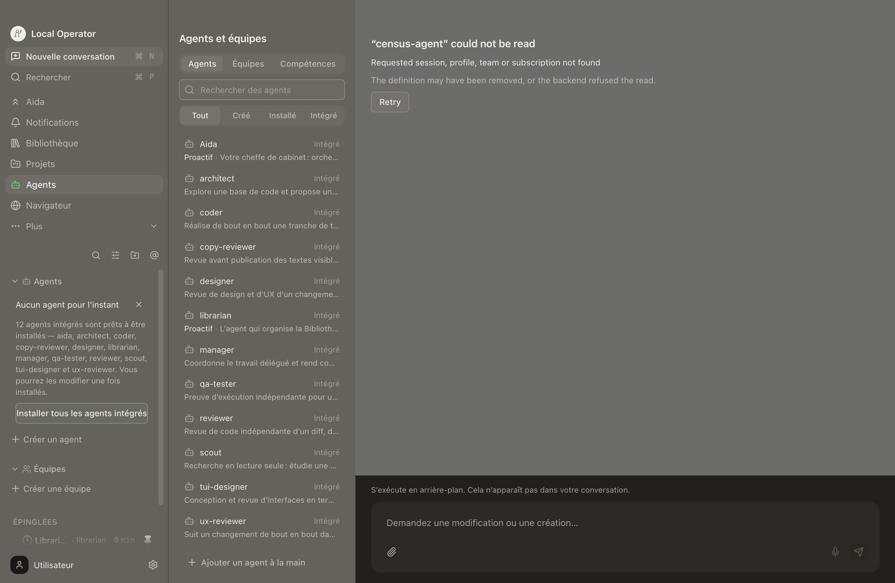
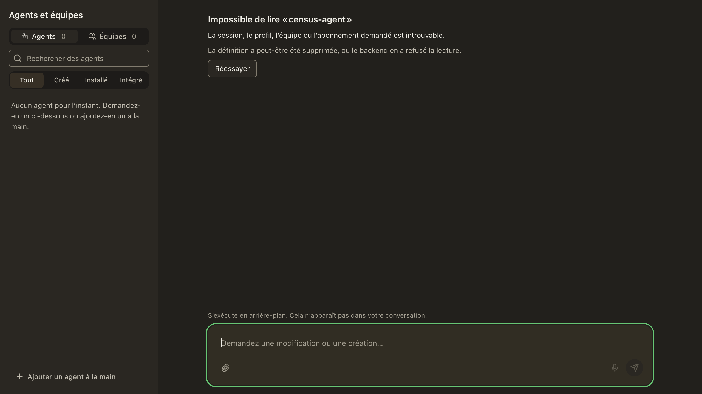
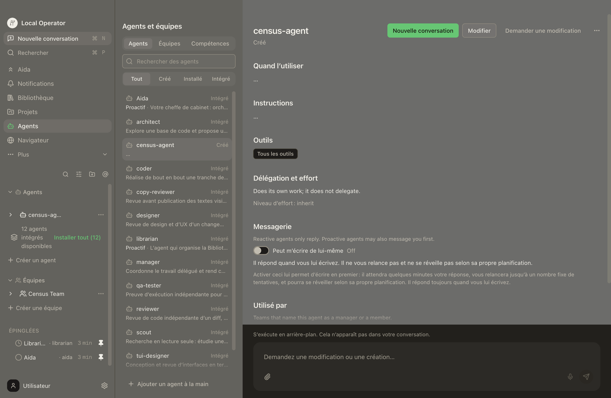
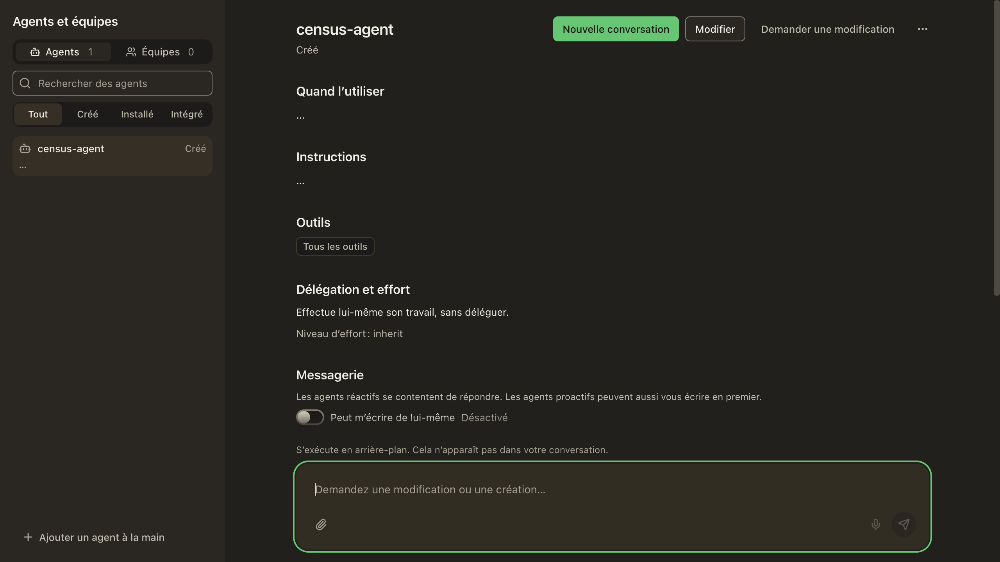
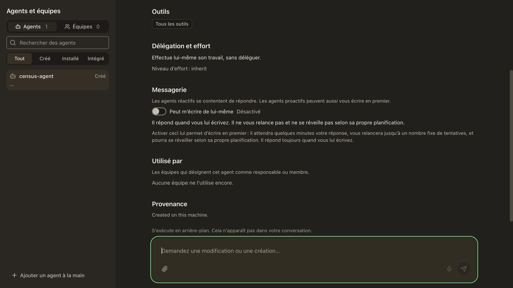
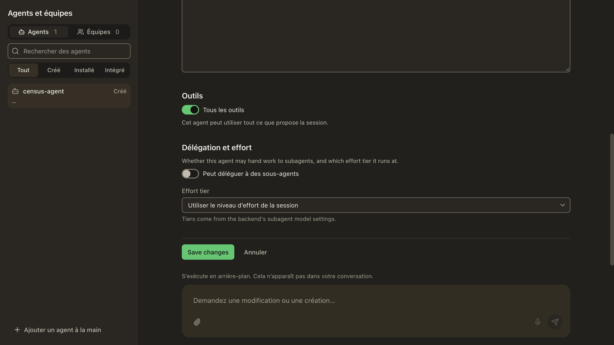

# Agent detail read-state localization — 2026-11-01

## Scope and provenance

The before frames came from the independent frame census, UI main
`9e20225249c`, session `79b74ef4f711`, `frames/fr-agent-detail.png` and
`frames/fr-agent-populated.png`. Both were opened and visually inspected before
being copied here byte-for-byte. They show the actual full desktop app in French:
all four missing-definition strings are English; the populated detail leaks the
three explanatory sentences and the switch status `Off`.

The after frames show **the real `AgentsPage`, `AgentDetail`,
`MissingDefinitionError`, `PaneError`, locale runtime and desktop transport** in
Storybook via the harness browser. Only the backend is stubbed. These are rendered
component proof, **not a rebuilt packaged/native application claim**. The census
contains the whole app shell at 2760×1800; the after browser captures the page-only
story at 2560×1440. They compare copy and states, not pixel-identical geometry.
No claim is made about other pages, languages' layouts, or the entire census.

## Reproduce after frames

From the PR checkout, using its existing dependency tree:

```sh
STORYBOOK_DISABLE_TELEMETRY=1 node node_modules/storybook/bin/index.cjs dev \
  -p 6137 --ci --no-open --disable-telemetry
```

Use the harness `browser` tool (no second browser engine):

1. Open `http://localhost:6137/iframe.html?id=agents-detail-read-state-localization--missing-french&viewMode=story&args=locale:fr`.
2. Wait for `Impossible de lire « census-agent »`, then screenshot.
3. Navigate the same tab to `http://localhost:6137/iframe.html?id=agents-detail-read-state-localization--populated-french&viewMode=story&args=locale:fr`.
4. Wait for `Effectue lui-même son travail, sans déléguer.`, then screenshot.
5. Click `role=heading[name="Utilisé par"]` to bring the lower detail content into
   view, then screenshot. Close the session-owned browser tab afterward.

`agent-detail-read-state.stories.tsx` specifies both reproducible states. Both
select `name=census-agent`; the missing fixture returns HTTP 404 with
`detail.code=wire.errors.desktop.requested_not_found` and the **unchanged English
wire fallback**. The populated fixture is a custom reactive role, no delegation,
no effort override, no tools restriction, description/instructions `…`, and no
teams. Storybook's existing `LocaleFrame` owns `args.locale=fr`.

## Before / after

### Missing definition




Observed after:
- `Impossible de lire « census-agent »`
- `La session, le profil, l’équipe ou l’abonnement demandé est introuvable.`
- `La définition a peut-être été supprimée, ou le backend en a refusé la lecture.`
- `Réessayer`

### Populated definition





Observed after: all three scoped explanatory sentences are French, and the
reactive switch says `Désactivé`. `inherit` deliberately remains a raw backend
tier token in the read view. Picker labels are human copy while submitted ids
remain `inherit`.



To reproduce the picker frame, click `role=button[name="Modifier"]` in the
populated story, then bring `text=Utiliser le niveau d’effort de la session`
into view. The selected combobox value is French; its stored id is not renamed.
Existing English edit-form headings/helpers and Save changes are outside this
read-state cluster and remain untouched.

The lower frame also exposes the pre-existing English provenance sentence
`Created on this machine.` This is outside the delegated cluster and was not
changed; these frames are not a claim that every detail string is localized.

## Automated discriminating check

```sh
node --test scripts/agents-remaining-literals.test.mjs \
  scripts/agents-source-and-recency-locale.test.mjs
```

19 tests pass. The detail regression mounts the production components in French
and Urdu against their **bundled** translations, checks actual DOM text for both
read states, the raw read-view effort token, and the human picker label after
pressing Edit, and exercises typed and legacy
not-found responses. Additional coverage checks unknown refusals remain intact,
ICU-looking names stay data, Retry invokes its callback, and pending retry is
localized and disabled. The negative control rebuilds only the not-found call
site back to English and confirms that the same visible-text assertion fails.
This DOM check complements, rather than replaces, the rendered frames.
