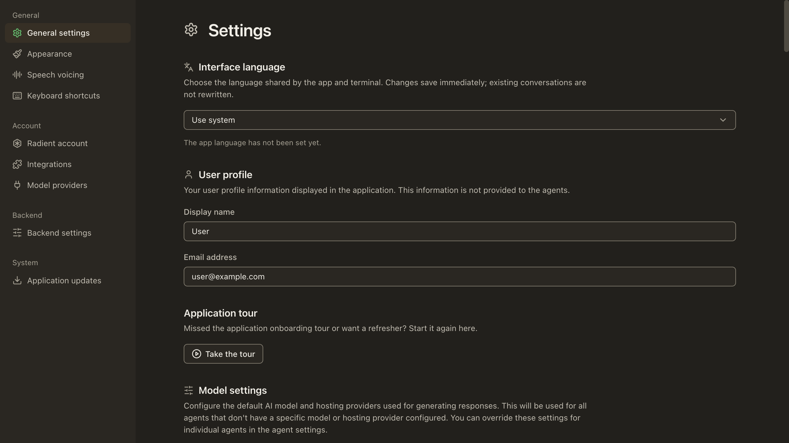
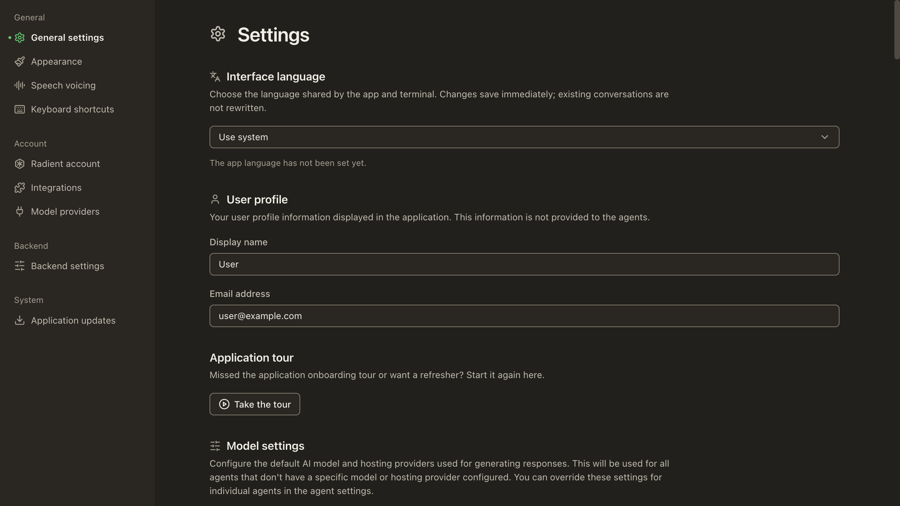
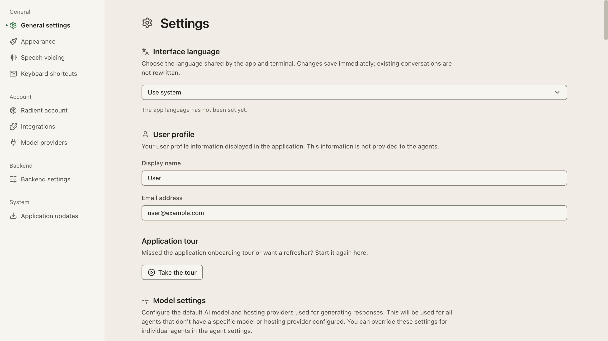
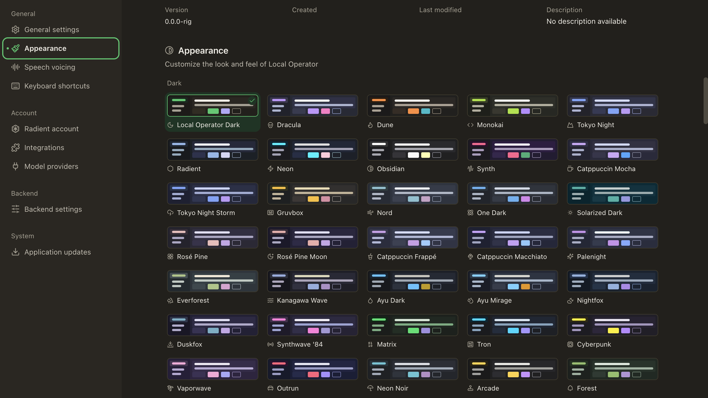
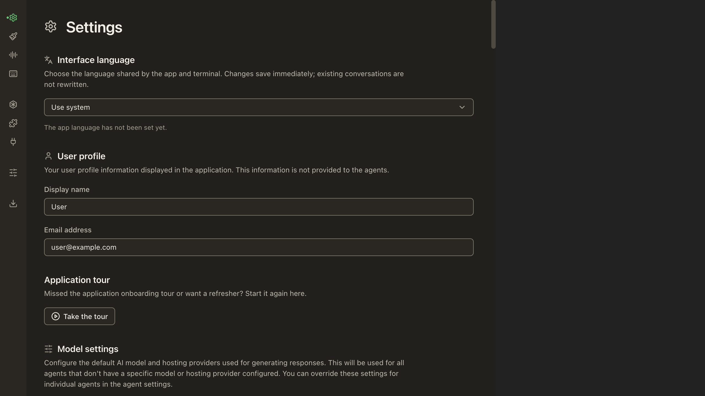
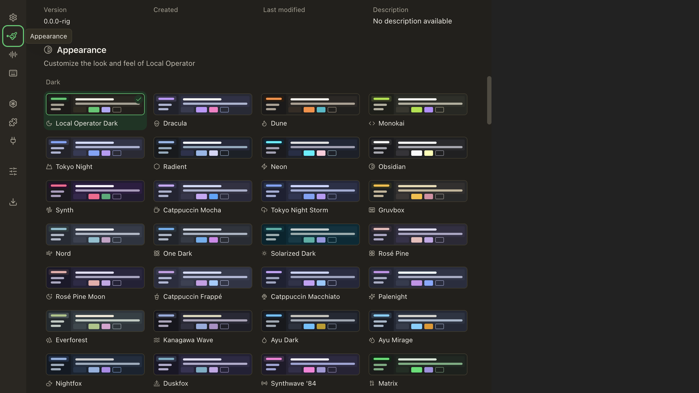

# Settings sidebar matching backgrounds — PR #1025

## Provenance and scope

Captured by the manager session through the harness browser, not a scripted
browser. Before source base: `db984348aa602baabe54c93b92744299f900737b`.
After source: `fe414fc26eb46b19fc39afae3d767d804109b00c`.
Actual shipped SettingsPage, actual ThemeProvider/GlobalScrollbarStyles,
production CSS and explicit Tailwind source scan, synthetic desktop bridge.
This is a renderer-only fixture, NOT native Electron or live-backend validation.
No screenshot is claimed to validate keyboard navigation, errors, loading, empty
states, or all themes. Coder inspected the before/after dark frames too.

The before frame shows the active selected plate; inactive destinations already
matched. The after dark/light frames remove that plate. Current-page ink, weight,
accent glyph and an absolute gutter dot retain the cue without reflow.

## Reproduction

Committed harness: `scripts/backend-settings-geometry.vite.mjs`, `.html`, `.tsx`,
`.css`. Isolated scratch config narrows optimizeDeps.entries to this HTML,
adds actual ThemeProvider/GlobalScrollbarStyles and sets the actual theme store
from the query. Vite starts with isolated HOME and env -i (no inherited CMUX_*
or XPC_FLAGS), telemetry off, port5263,1100MB process-group bound. No native build.
Existing dependency tree from a byte-identical lockfile; no install or copy.

URL: http://127.0.0.1:5263/backend-settings-geometry.html?theme=localOperatorDark
Light: query `theme=localOperatorLight`.
Collapsed: scratch middleware `/settings-collapsed.html` holds this exact page
in an iframe900px wide ×760px high, so matchMedia uses a real900px viewport.

## Actual reported browser measurements

Source: manager's browser measurements (not inferred from screenshots).

| Surface | Before/after observation | Result |
|---|---|---|
| Dark populated expanded | Before current fill differs; inactive transparent already matches nav | reproduced active-fill mismatch only |
| Dark populated after | nav rgb(43,39,33), both states rgba(0,0,0,0), border0 | resting surface matches |
| After text | active600 / rgb(241,238,230); inactive400 / rgb(194,188,175) | current cue retained |
| Actual900px collapsed | dot + accent icon, no plate; screenshot | narrow treatment inspected |
| Light after | nav rgb(247,245,238); both states transparent, border0 | resting surface matches |

Appearance click updated aria-current and measured a solid accent outline, but
its subsequent screenshot returned identical earlier bytes. That frame is NOT
included or claimed as focus/navigation evidence. Independent QA must validate
interaction separately.

## Local targeted matrix and limitations

- RED focused test: current=true labelled=true expected bg-transparent, actual
  bg-row-selected (1fail); GREEN focused Settings/direct-chat-neighbor matrix
  11pass0fail325ms.
- Complete small route/lane suites9pass0fail490ms.
- Changed-file Biome + scripts ratchet exit0; warnings remain; diff-check clean.
- Classification only: lint/types/unit/pack selected. CI runs terminal full gates.
- Whole selection-file attempt cap-killed at700MB, no result: NOT pass.
- Prepush scripts/src lint passed; serial typecheck reached app config then
  cap-killed at0.9GB vs700MB ceiling. Supported PREPUSH_BYPASS with host hold
  reason used, no hook/config change. No full local app typecheck pass claimed.

## Frames

## Byte identity

- `before-dark.png`: 218259 bytes, PNG (2560, 1440), SHA256 `25580d8e7c2705d9034fc9c6427de325f1387df7e1def1eda0a2b0640c124d07`
- `after-dark.png`: 217525 bytes, PNG (2560, 1440), SHA256 `958ed445544cbd040531f2687ef815635bcfcf83d5fae8fa0bab5c3c9f82bf33`
- `after-collapsed-dark.png`: 170190 bytes, PNG (2560, 1440), SHA256 `70800284149168b253e6ff68b1439f62ec033a09140f3763b666724e7af4ae16`
- `after-light.png`: 215691 bytes, PNG (2560, 1440), SHA256 `f789ff71b8b4c039fbc2f61ae3beb4d31e4c08d7e3906408e367357edc217959`

## Independent QA pointer-flow evidence

Source: independent qa-tester report round1, actual model openai/gpt-6.1-sol:
https://github.com/damianvtran/local-operator-ui/pull/1025#issuecomment-6157749274
The QA tester used one harness browser tab and independently clicked Appearance
in expanded and actual900px collapsed renderers. Current source head:
13cd21d17182e8e3573300412835f17a36260a6c (byte-identical renderer/scripts
to earlier photographed headfe414fc26).

Expanded General→Appearance frames show a moved current dot, visible2px accent
focus outline and actual destination theme grid. QA measured selected row
204×32 at y71.4, dot4×4 at y85.4, and destination anchor y79.78.
Collapsed click frames show moved current state and scroll; collapsed styles and
post-click aria metrics were tool-blocked, not claimed measured. These images
replace neither the manager-before provenance nor the disclosed stale manager
post-click frame; they are separately captured independent interaction evidence.

Pointer flow PASS; keyboard/forced hover/native/live backend NOT exercised.
The isolated scoped regression is QA2pass0fail277.5ms. QA separately disclosed
an unisolated source-only24/24 run; it does not substitute for isolated/full CI.

- `qa1025-dark-general.png`: 217525 bytes, PNG (2560, 1440), SHA256 `958ed445544cbd040531f2687ef815635bcfcf83d5fae8fa0bab5c3c9f82bf33`

- `qa1025-dark-appearance.png`: 266019 bytes, PNG (2560, 1440), SHA256 `7e5e7c5c1e0394b2fc1e368b4df947efa07993600e4db6411edc00a3b995a573`

- `qa1025-light-general.png`: 215691 bytes, PNG (2560, 1440), SHA256 `f789ff71b8b4c039fbc2f61ae3beb4d31e4c08d7e3906408e367357edc217959`

- `qa1025-collapsed-general.png`: 170194 bytes, PNG (2560, 1440), SHA256 `ab7b67ec76cc84e3a693f2c0c458a8297b250d570bb8dbd16e6b22560d1c70af`

- `qa1025-collapsed-appearance.png`: 195271 bytes, PNG (2560, 1440), SHA256 `c42f7c125b5aac864f00e4c6ebc48b9b300f0ba56cab4c20a4743052e00884f2`

