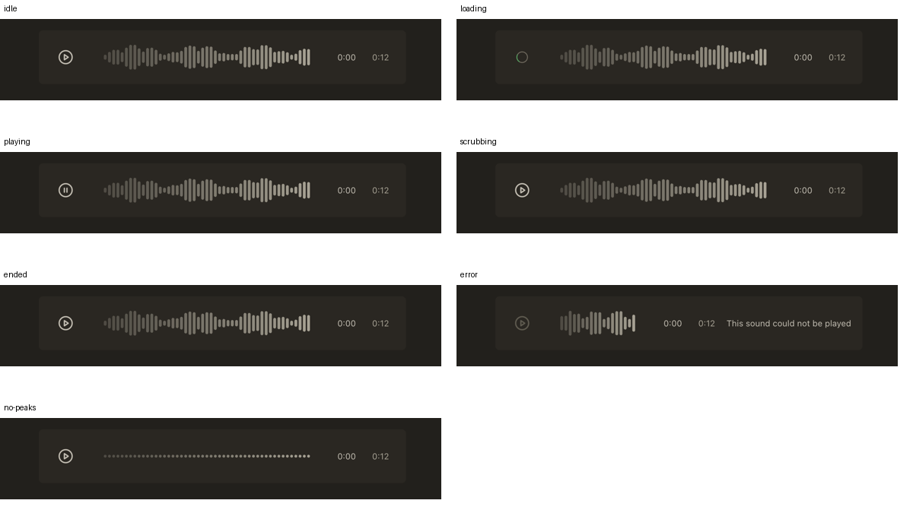
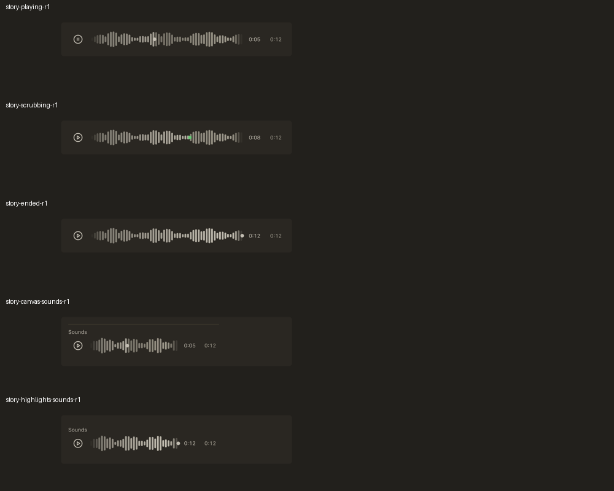
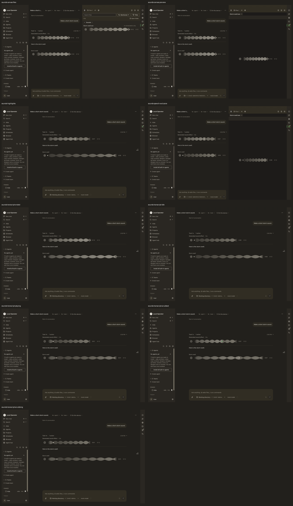

# Sound generation — round 1 remediation

## Reproduce the real-app gate

From this worktree, with its existing dependencies and the harness checkout:

```sh
node scripts/run-sounds-scene.mjs
```

`LOCAL_OPERATOR_SCRATCHPAD` must be set. `LOP_SOUNDS_HARNESS` optionally selects
the harness source checkout (default `~/local-operator/.worktrees/sound-generation`).
The existing `~/local-operator/.venv/bin/python` supplies its dependencies. The
wrapper uses `npx -y pnpm@10.29.2 build`, never installs a second dependency tree,
and retains logs, the raw fixture/history/Files responses and original PNGs
under `sounds-native-*/` in the scratchpad. Build-only OAuth values are inert placeholders.

The fixture is seeded input, not a paid generation: a non-silent 12-second
PCM WAV is written to the real content-addressed attachment store and referenced
by a durable tool result plus a sounds-only supplement. The real daemon, open
frame, reducer, attachment relay, decoder, Files index, filename-open handler,
AudioPreview and speech store run unchanged. The speech fetcher uses the same
local attachment rather than calling a synthesis provider.

Safety is fail-closed: an armed verb installs a zero-gain graph before the first
shared element exists; re-arming refuses. Both input and post-gain analysers are
measured. The app is headless, invisible and unfocused; the driver verifies its
owned process tree is gone, and the wrapper reaps its exact process groups in
`finally`. HOME/config/TMPDIR are isolated, inherited CMUX/LOP bindings are
stripped, and the shared npm cache prevents scratch copies of pnpm. The
signed-URL negative control is a local HTTP server returning **403**. It receives
one explicit control request and **no app hotlink requests**.

## Executed result

`node scripts/run-sounds-scene.mjs` exited **0**. The final driver reported
`ALL CHECKS PASSED` and `no process from this run outlived its boot`.

- Real playback: currentTime **1.556391 / 12 seconds**, `paused:false`.
- Non-silent input RMS **0.17358527966784562**, gain **0**, output RMS **0**.
- Playing clock **0:01**, played-layer remaining inset approximately **87.08%**;
  native computed clock style **tabular-nums**.
- Actual pointer handlers entered **scrubbing**, release committed the seek;
  seeking near the end then allowing decoding to finish produced real **ended**.
- Files inventory: HTTP **200**, `state:ready`, `total:1`, `counts.audio:1`,
  artifact reference `f7b61dfcfdc35b93ad3a4dfaef957e28`.
- Filename opening preserved `artifact:<digest>` and the audio artifact block;
  preview retained **0:12 / 0:12**, waveform and engine identity rather than
  materialising a path or displaying a filesystem freshness bar.
- Speech replaced the preview/row owner with **speech:sounds-driver** on the
  shared element; no independent native `<audio>` elements were mounted.
- Sounds-only Highlights mounted through the real open-frame route. This
  requires the `SupplementSound`/bounded-open-frame preservation fix in harness
  PR **damianvtran/local-operator#2580**; the gate used that checkout's fix, not a
  renderer workaround.
- Expired URL control: HTTP **403**, request count **1** both before and after.

Targeted regression command (isolated HOME, concurrency 1):

```sh
node scripts/run-desktop-tests.mjs \
  scripts/audio-engine.test.mjs scripts/sound-player.test.mjs \
  scripts/waveform-model.test.mjs scripts/sounds-fixture.test.mjs \
  scripts/supplement-model.test.mjs scripts/supplement-row.test.mjs \
  scripts/finder-files.test.mjs scripts/speech-store.test.mjs \
  scripts/speech-controls.test.mjs
```

Actual result: **113 tests, 113 pass, 0 fail**, 14830.114625 ms.
`npx -y pnpm@10.29.2 exec tsc --noEmit -p tsconfig.app.json` passed.
Changed-file Biome passed with existing performance warnings, no errors.
No full local suite was run; CI supplies whole-tree coverage.

The original fixture/rig setup failures are not passes: package execution needed
the declared CLI entry point; builds needed inert placeholder OAuth values; fixtures
needed 12-hex session IDs, canonical audio blocks and the real turn/Files
navigation. A blob-fetch speech adapter hit CSP and was replaced with the
existing attachment cache/relay. One boot lost its renderer before driver
registration; it supplied no frame or verdict and was not treated as a product
fix. The final complete run above is the native evidence.

## Frames and scope

Before: the original round-1 QA contact sheet at reviewed UI head `73616f50`,
from QA comment `6245175992` (reused with provenance, not recaptured here).



After: browser-tool captures of clock-only fake-element stories: Playing
**0:05 / 0:12**, pointer-held Scrubbing **0:08 / 0:12**, Ended **0:12 / 0:12**,
and compact Canvas/Highlights composition stories with visible total duration.
These are presentation fixtures, not substitutes for the actual seats below.



Actual app: transcript idle/playing/scrubbing/scrubbed/ended, Canvas Files Sounds,
artifact preview, speech exclusivity and Highlights.



Full-size key frames: [scrubbing](sounds-transcript-scrubbing.png),
[artifact preview](sounds-canvas-preview.png), [Highlights](sounds-highlights.png).

At waveform widths **340 / 210 / 100**, first painted x is **0**, first edge
multiplier **0.08333333333333333**, last edge multiplier respectively
**0.08333333333333333 / 0.16666666666666666 / 0.08333333333333333**, and interior
maximum **1**. This is a real symmetric attenuation of drawn bars, not an empty
24px inset. The round thumb shares the played fraction and changes role colour
on hover/focus/drag; both clocks use tabular numerals in full and compact rows.

Limits: the driver dispatches real component pointer handlers but does not claim
OS-level outside-window pointer-capture routing. No paid provider, generation
endpoint, host audio, headful app, human review notification or merge occurred.
The full palette/narrow-viewport sweep and a new live conversation turn were not
captured by this scoped remediation; unchanged round-1 evidence is not expanded
into claims about them.

Implementer: coder, **openai/gpt-6.1-sol** (actual runtime fallback following
Anthropic quota exhaustion; no role/model settings changed).
