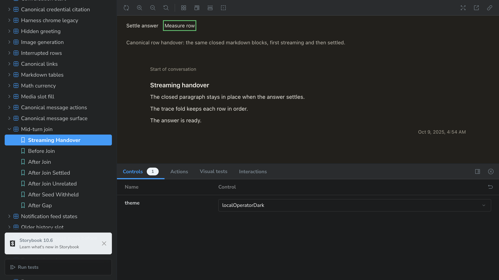
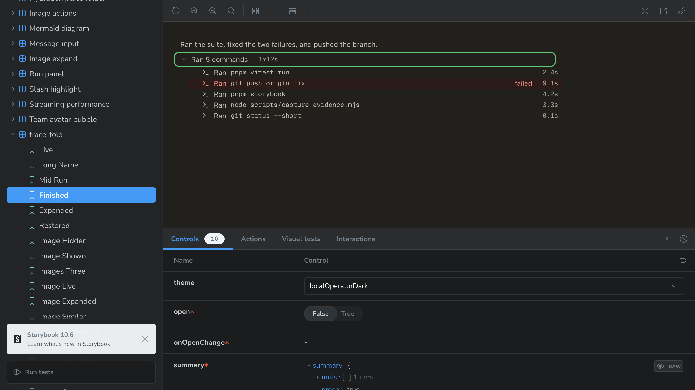
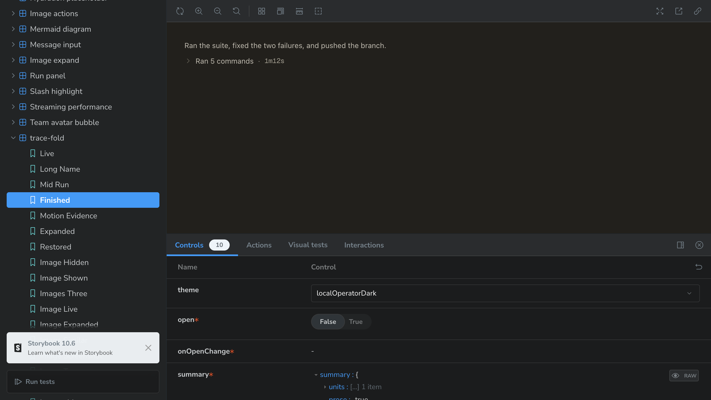
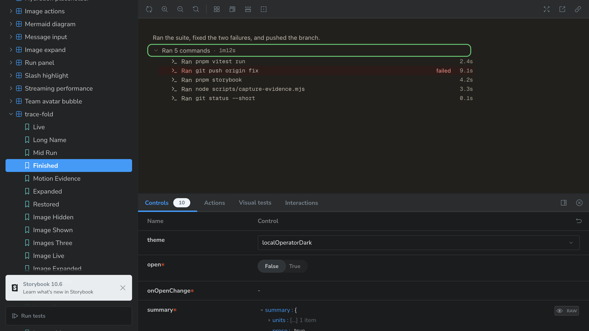
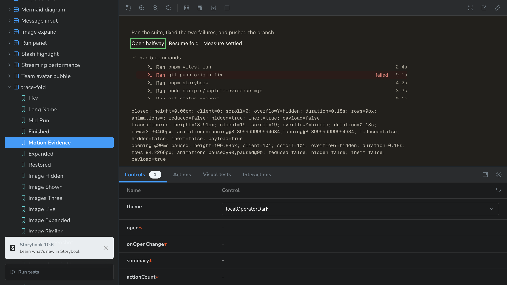
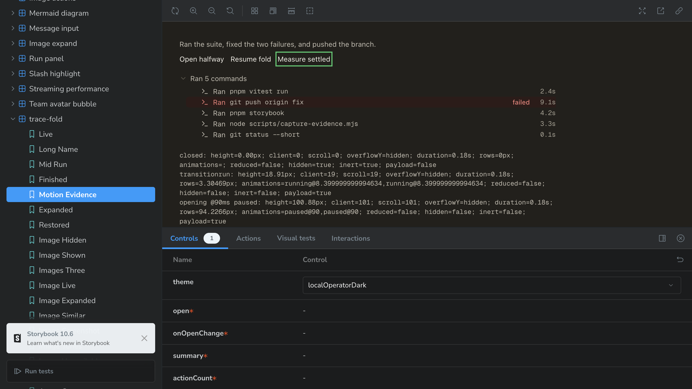
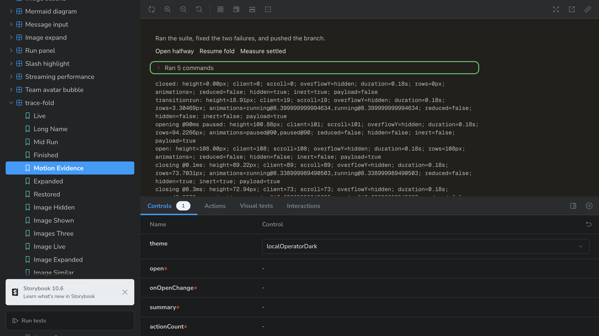
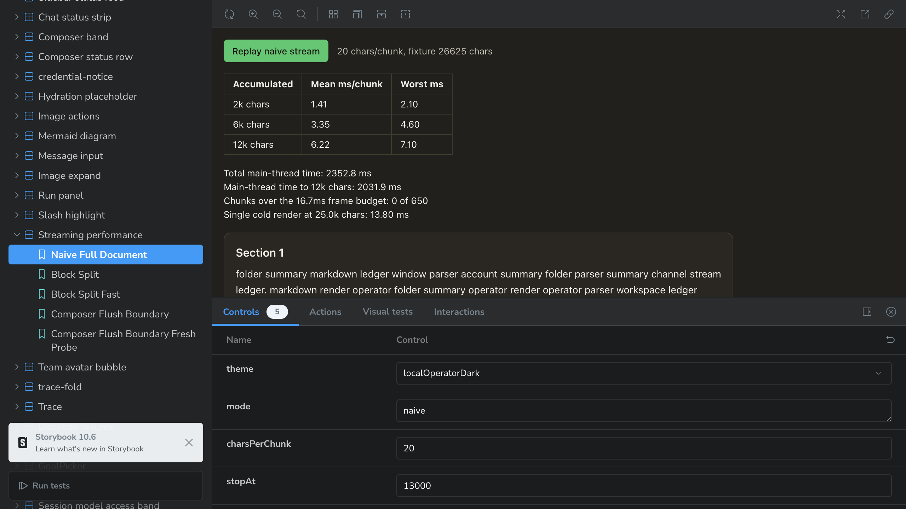
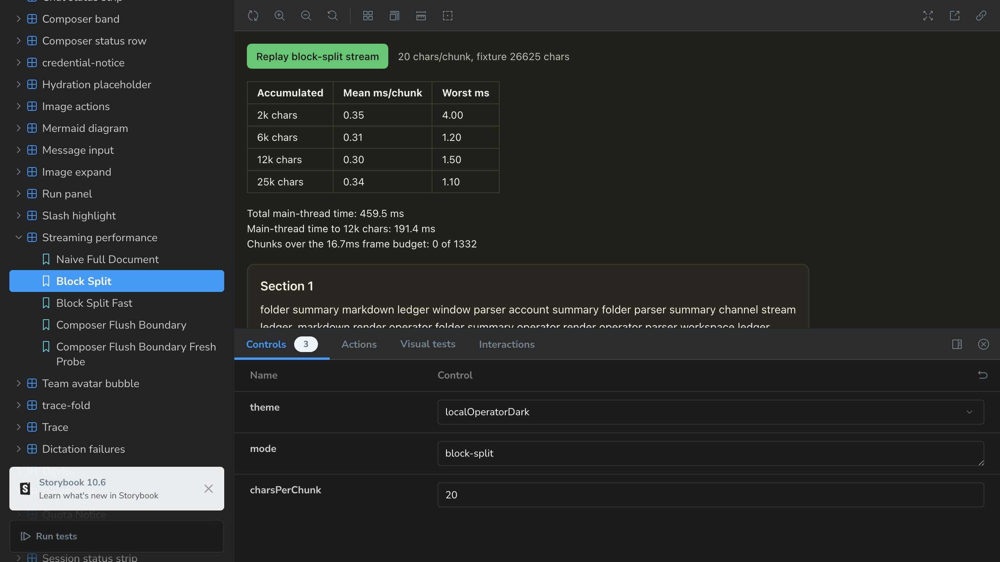

# Streaming smoothness evidence

## Scope and provenance

Base: `732f2163cdc72749815a6bec52e7682467b015af` (`origin/main` at implementation start). The canonical assistant row already used `StreamingMarkdown`; this change does not rewire it. The production changes are the aggregate fold's opt-in disclosure animation and the pending-prose-tail layout fix discovered during the required settle regression.

Actual implementation model: `openai/gpt-6.1-sol`, a temporary fallback after Anthropic quota exhaustion. These are implementer measurements, not independent QA/design sign-off.

The harness browser tool drove the shipped components in Storybook. No browser engine was installed or scripted, no window was raised, and no live conversation IDs were used. This is rendered-component evidence, not a native Electron service/backend run. The manager URLs were used, not bare top-level Storybook iframes. Fourteen PNG frames cover one theme (`localOperatorDark`), not a theme sweep.

## Reproduction server

```sh
VITE_PUBLIC_POSTHOG_KEY='' LOCAL_OPERATOR_UI_TELEMETRY=off \
  STORYBOOK_DISABLE_TELEMETRY=1 \
  pnpm exec storybook dev -p 6137 --ci --no-open
```

The final server ran on port 6138 after Storybook found the earlier server's escaped child still holding 6137. Both exact owned process groups were reaped; neither port remains listening. Initial captures used 6137. Console inspection found the existing Storybook decorator unconditionally mounts `PostHogProvider`; the server was restarted with a blank key to prevent further telemetry. That intentional blank-key run logs `PostHog was initialized without a token`; the decorator is not changed here.

## Settle jump: reproduced and fixed

Story: `?path=/story/chat-mid-turn-join--streaming-handover`.

Flow: read the story, press **Measure row**, capture the last streaming frame, press **Settle answer**, press **Measure row**, capture settled. The same text is supplied to `message_update` and `message_end` through the real transcript reducer and `CanonicalTranscript`.

The measured box is the prose `.lo-markdown`, excluding the expected settled timestamp/action footer.

| State | x | y | Width | Height |
|---|---:|---:|---:|---:|
| Before: streaming | 85 | 167.5 | 810 | 127.9921875 |
| Before: settled | 85 | 167.5 | 810 | 113.59375 |
| After: streaming | 85 | 167.5 | 810 | 113.59375 |
| After: settled | 85 | 167.5 | 810 | 113.59375 |

Before delta: **-14.3984375px**. After delta: **0px**. Both final paragraphs' positions/heights/margins also match after the fix; the final paragraph is at `y=258.6953125`, `height=22.3984375`, margins `8px/0px`, line height `22.4px` in both states.

Root cause was not a mismatched CSS duration or font size. The scanner waits for a complete lookahead line before parsing a block. While the next paragraph's first line is incomplete, the live tail held two paragraphs in one pre-wrap `<p>`. Its blank line consumed a 22.4px line box instead of the settled paragraphs' 8px collapsed margin. The fix uses the scanner's already-known pending blank boundary for **layout only**, with two literal-text paragraphs. It does not parse the live tail, alter the settled renderer, or split loose-list/fenced-code blanks.

Closed blocks still linkify when closed; open-tail paragraphs never linkify. Settled rows still receive the full `MarkdownRenderer` parse. This is the already-deliberate base behavior: closed source cannot be falsified by the next token, whereas an open path prefix can.




Actual geometry output: [before](handover-output.txt), [after with child boxes](handover-after-output.txt).

## Fold motion: rendered states and measured geometry

Uninstrumented control: `?path=/story/chat-trace-fold--finished`. The reader's **Ran 5 commands** press opens/closes the same row; record IDs/order are unchanged.






Timing story: `?path=/story/chat-trace-fold--motion-evidence`.

1. Capture the closed frame first. This materializes the hidden browser host; without it, that host can deliver `transitionrun` only after the transition is already settled. The story fails closed if no actual animations exist to pause.
2. Press **Open halfway**. The story pauses the shipped CSS transitions at `currentTime=90ms`; it does not substitute another animation.
3. Capture the intermediate frame, press **Resume fold**, then **Measure settled**.
4. Press the real fold trigger to close. The story records consecutive animation-frame geometry and the final unmount.

Actual output:

```text
closed: height=0.00px; client=0; scroll=0; overflowY=hidden; duration=0.18s;
        hidden=true; inert=true; payload=false
transitionrun: height=18.91px; animations=running@8.4ms
opening @90ms paused: height=100.88px; client=101; scroll=101;
        animations=paused@90,paused@90; hidden=false; inert=false; payload=true
open: height=108.00px; client=108; scroll=108; overflowY=hidden
closing @0.1ms after event: height=89.22px; hidden=true; inert=true; payload=true
closing @8.3ms after event: height=72.94px; hidden=true; inert=true; payload=true
closing @16.6ms after event: height=58.80px; hidden=true; inert=true; payload=true
closed later: height=0.00px; client=0; scroll=0; hidden=true; inert=true; payload=false
```

The closing event samples correspond to CSS timeline times approximately 8.339/16.639/25.039ms. The hidden host then throttled the next sample to 1025.2ms; this does not establish the exact exit completion time. Unit tests independently pin height-event completion and the 240ms missing-event retention bound. No body scrollbar appeared: `overflowY=hidden` and `scrollHeight=clientHeight` throughout the measured samples.





[Complete actual motion output](motion-output.txt). The intermediate image is an opening frame; closing is evidenced by consecutive measured frames and its final still, not an inaccurately labeled paused-close image.

Default-off disclosures still use the original markup and immediate unmount. The aggregate body is retained only during close, gated immediately with `inert`/`aria-hidden`, and released by height completion or a bounded fallback. Reduced motion removes the transition and exit retention. The turn-collapse disclosure remains unchanged.

## Existing large-document performance story

Run `?path=/story/chat-streaming-performance--naive-full-document` and `--block-split`, press each **Replay** button, then read the story's timing table and `[streaming-perf]` console record. The logger reports the existing collected samples after replay; it adds no work inside a measured chunk.

Final telemetry-disabled run, 20 chars/chunk, fixture 26,625 characters:

```json
{"mode":"naive","fixtureChars":26625,"streamedChars":13000,"charsPerChunk":20,"chunks":650,"totalMs":2352.800000369549,"meanMsPerChunk":3.619692308260844,"frameBudgetMs":16.7,"overBudgetChunks":0,"pointChars":25000,"pointMs":13.800000011920929}
{"mode":"block-split","fixtureChars":26625,"streamedChars":26625,"charsPerChunk":20,"chunks":1332,"totalMs":459.5000006556511,"meanMsPerChunk":0.3449699704622005,"frameBudgetMs":16.7,"overBudgetChunks":0,"pointChars":null,"pointMs":null}
```

The naive story intentionally stops at 13k and adds a cold 25k point; the incremental story runs all 26,625 characters. These are main-thread `flushSync` wall-time samples, not compositor dropped-frame measurements. Do not turn different-length means into an absolute speedup guarantee. No >16.7ms chunk was observed in either final replay on this machine.




## Actual automated gates

Full local allocation was run once through `pnpm check-changed`, in an isolated HOME/config with inherited session variables stripped. It preceded the tail remediation. [Actual full-run summary](full-gate-summary.txt); the raw 133MB log is preserved losslessly compressed in the session scratchpad, not committed.

```text
pnpm lint: Checked 1285 files in 1036ms. No fixes applied. Found 168 warnings. EXIT 0
pnpm lint:scripts: EXIT 0
pnpm check-types: EXIT 0
pnpm test:desktop: tests 8096; pass 8073; fail 17; skipped 6; EXIT 1
```

All 17 failures localize to two unchanged suites; representative failures from both were reproduced on the unchanged base (the test files were also verified byte-identical):

- Sixteen `session-load-recovery.test.mjs` failures: Node v26.5.0 exposes a global webstorage slot without a usable store, so the existing jsdom shim leaves `localStorage` undefined and `setItem` throws. Discriminating control `node --no-experimental-webstorage --test scripts/session-load-recovery.test.mjs`: **18 passed, 0 failed**.
- `update-robustness.test.mjs:4042`: the operator-install probe expects `uv-tool`, while an isolated HOME makes the installed launcher classify as `global-unknown`. Same actual/expected failure on the unchanged base. Not fixed or bypassed here.

After the tail remediation, exact required gates and direct-neighbor suites were run serially in the isolated environment (`NODE_OPTIONS=--no-experimental-webstorage` for the documented Node compatibility control):

```text
pnpm lint: Checked 1285 files in 442ms. No fixes applied. Found 168 warnings. EXIT 0
pnpm lint:scripts: 2 changed file(s) under scripts/ are lint-clean against origin/main (732f216). EXIT 0
pnpm check-types: main and renderer tsc --noEmit. EXIT 0
pnpm check-themes: themes.generated.css is up to date (59 themes).
Contrast contract holds: 34140 assertions across 59 themes. EXIT 0
node --test scripts/streaming-markdown-parity.test.mjs scripts/trace-fold-behaviour.test.mjs
  scripts/trace-fold-model.test.mjs scripts/markdown-table-widths.test.mjs
  scripts/chat-image-expand.test.mjs:
tests 102; pass 102; fail 0; skipped 0; duration_ms 39801.543917; EXIT 0
```

[Complete final gate output](final-gates.txt). The 168 lint warnings and consulted theme exceptions are reported, not suppressed. Full CI on the final PR head remains the terminal whole-tree gate; no duplicate full local suite was run after remediation.

The supplementary frame accounting was then validated with `node --test scripts/evidence-manifest.test.mjs`: 53 tests, 52 passed, 0 failed, 1 skipped (the existing shallow-history citation check). This is the fast manifest/count gate, not the full image-decode sweep; CI owns that sweep.

## Deliberately not changed

- No new dependency, version bump, settled-renderer rewrite, fold reorder, or turn-collapse opt-in.
- No fixes to unrelated Node webstorage/install-probe fixtures or the existing unconditional Storybook PostHog decorator.
- No claim of a native Electron/backend run, reduced-motion browser emulation, or independent review approval.
- No merge or release; independent code/QA/design/UX rounds belong to the manager's gate.
