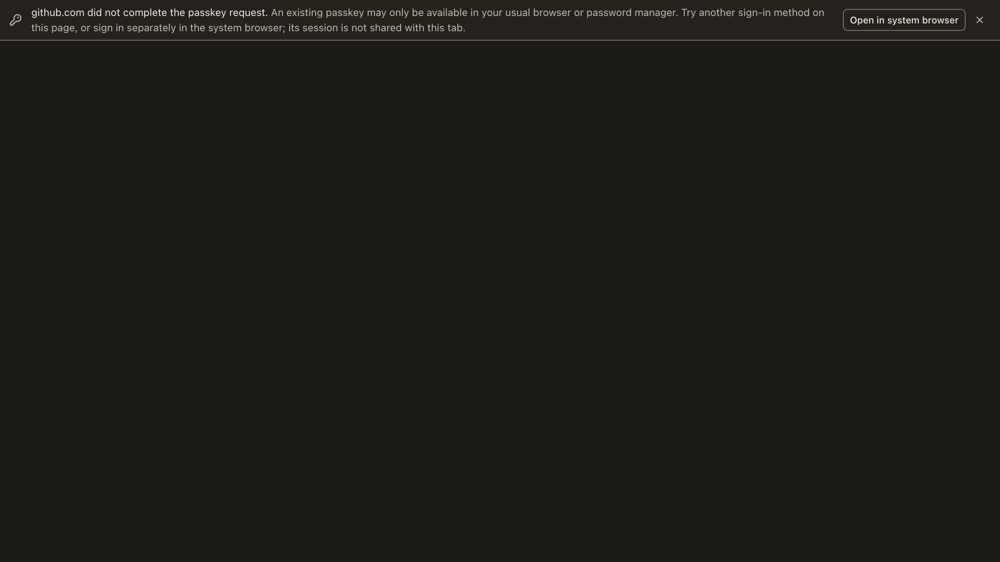

# Passkey recovery: evidence and capability boundary

Operator request: “Passkey authentication doesn't seem to be properly working in the local operator ui browser, can you review why this is and push a robust fix”. The reported page was GitHub's WebAuthn two-factor sign-in with “Authentication failed”.

## Diagnosis

Read-only `codesign -dv --verbose=4 '/Applications/Local Operator.app'` identified bundle `com.local-operator`, team `SHA2U6KT7V`. Reading only the relevant entitlement keys found `SHA2U6KT7V.com.local-operator.webauthn`, no associated-domains or web-browser public-key-credential entitlement, and an embedded provisioning profile. `codesign --verify --deep --strict` exited 0. Historical documentation saying the installed app has no keychain entitlement is not current.

The configured provider is Electron's device-bound Touch ID authenticator; it does not retrieve existing Apple Passwords/iCloud/manager passkeys. No native ceremony was performed, and the exact cause of the user's GitHub rejection cannot be inferred from a screenshot. Electron's `platformPasskeys` route still requires per-RP associated-domain/AASA authorization; it is not a general solution for arbitrary third-party websites.

Two source defects made recovery disappear: `browser/index.ts` disabled the observer whenever Touch ID was configured; `passkey-notice.ts` ignored requests that rejected before its delayed observation. The fix observes explicit NotAllowed rejections in both gate states, keeps pending notices gate-off only, and offers optional recovery without diagnosing a provider failure. Native cancellation and missing credentials share `NotAllowedError` and cannot be distinguished here. Explicit abort and conditional mediation remain silent.

## Executed checks

| Surface | Command / interaction | Actual result |
| --- | --- | --- |
| Baseline observer | Bundle `git show 0331b07583134b06f641bb962b5f8ec67cbcc0ca:src/main/browser/passkey-notice.ts`; call rejected WebAuthn-shaped promise | Page rejection `NotAllowedError`; recovery signals `[]`; baseline source disabled observer when configured |
| Targeted tests | `node --test --test-concurrency=1 --test-timeout=120000 scripts/browser-startup.test.mjs scripts/passkey-notice.test.mjs scripts/webauthn.test.mjs` | 60 tests, 60 pass, 0 fail; includes production host injection, console signal and browser-state projection with configured Touch ID |
| Browser baseline | Harness browser on fixture `/?before=1`, “Synthetic NotAllowedError” | `{"settled":"rejected","name":"NotAllowedError"}`, signals `[]` |
| Browser fixed | Fixture `/?native=1`, “Synthetic NotAllowedError” | Same original rejection; signal ends `:get:not-allowed` |
| Real WebAuthn abort | Fixture `/?native=1`, “Real WebAuthn pre-aborted” | `{"settled":"rejected","name":"AbortError"}`, signals `[]`; no native sheet |
| Real origin enforcement | Fixture `/?native=1`, “Real WebAuthn wrong RP” (`127.0.0.2`) | `{"settled":"rejected","name":"SecurityError"}`, signals `[]`; no native sheet |
| Main/renderer compilation | Isolated HOME, `LOCAL_OPERATOR_UI_NO_BYTECODE=true`, explicit synthetic OAuth build values, `node_modules/.bin/electron-vite build` | Exit 0; renderer built in 13.79s. First setup attempt correctly refused missing `VITE_GOOGLE_CLIENT_ID`; no credentials were read |
| Focused formatting/lint | Biome on changed TS/TSX/scripts | Exit 0; warnings about regex placement, no errors |
| Copy context | `node scripts/i18n/context-parity.mjs` | Exit 0, every English key covered apart from existing allowed gaps |
| Main typecheck | Isolated `tsc --noEmit -p tsconfig.node.json` | Exit 0, no TypeScript diagnostics |
| Renderer typecheck | Isolated `tsc --noEmit -p tsconfig.app.json` | Resource-killed, exit -9, no diagnostic output; NOT a pass |

The fixture's success, NotAllowed, pending and conditional controls use **synthetic original promises** under the real compiled observer. They prove observer behavior, not a hardware credential, cloud provider, GitHub login or native sheet. The real abort/security controls use the browser's actual `navigator.credentials.get` and cannot create a credential or launch an authenticator sheet.

## Re-run with approved tools

1. Use the matching existing dependency tree; do not install another or mutate shared dependencies.
2. `node scripts/passkey-recovery-fixture.mjs` prints a loopback URL. Open it with the harness browser, reload between controls, use `?native=1` for configured-provider behavior and `?before=1` for the pinned baseline. The server itself never launches/drives a browser.
3. For the actual presentational band, run existing Storybook and open `iframe.html?id=browser-passkey-notice--not-completed&viewMode=story` with the harness browser. Stories also cover pending, agent-frame, narrow, absent and expired notices; dismiss is interactive. These are component frames, not a native authenticator proof.

## Rendered component

`not-completed.png` is the actual Storybook component at the changed source,
viewed through the harness browser (dark theme). It was opened and visually
inspected, not inferred from tests. It proves the optional recovery band's
copy/layout only, not native authentication. Independent design/QA must still
inspect narrow/RTL and interactive states.

## Gates and explicit limitations

Independent review, real-path QA, design/UX and CI are required before merge. Two changed copy keys are translated into all eight supported locales and independently audited by designer session `cf0bdbdda484`, actual served fallback `openai/gpt-6.1-sol`. Recording its portable receipt with `ledger-assemble.mjs` was blocked by the cross-session scratch-file guardrail; the manager queued explicit operator approval. No ledger import was retried or represented as complete.

No native Touch ID ceremony, USB key, iCloud/manager credential, real GitHub login, cookie transfer or cross-browser authenticated-session handoff is claimed. Opening externally starts/continues that browser's separate login; the embedded tab is not thereby authenticated. Another sign-in method on the embedded page is the recovery that can authenticate that tab. No version bump, keychain-group change, origin/security bypass, browser engine or platform-passkey feature advertisement was added.
