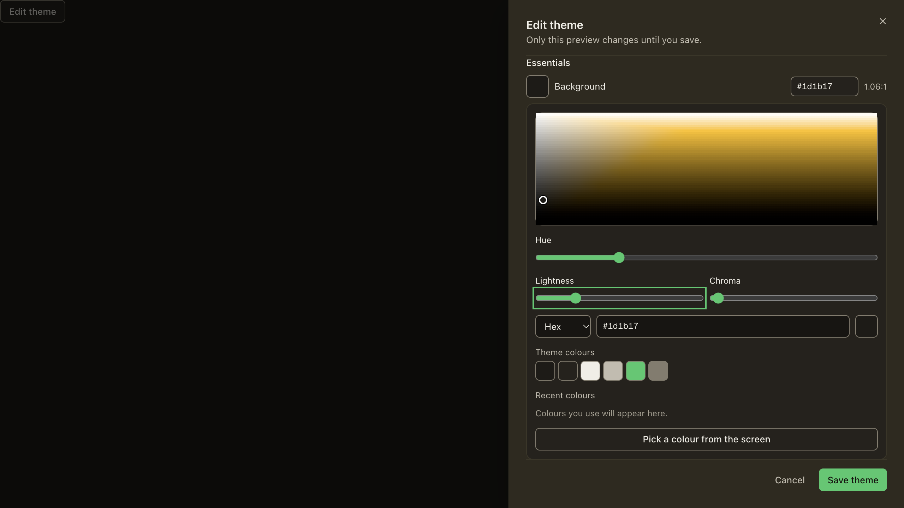
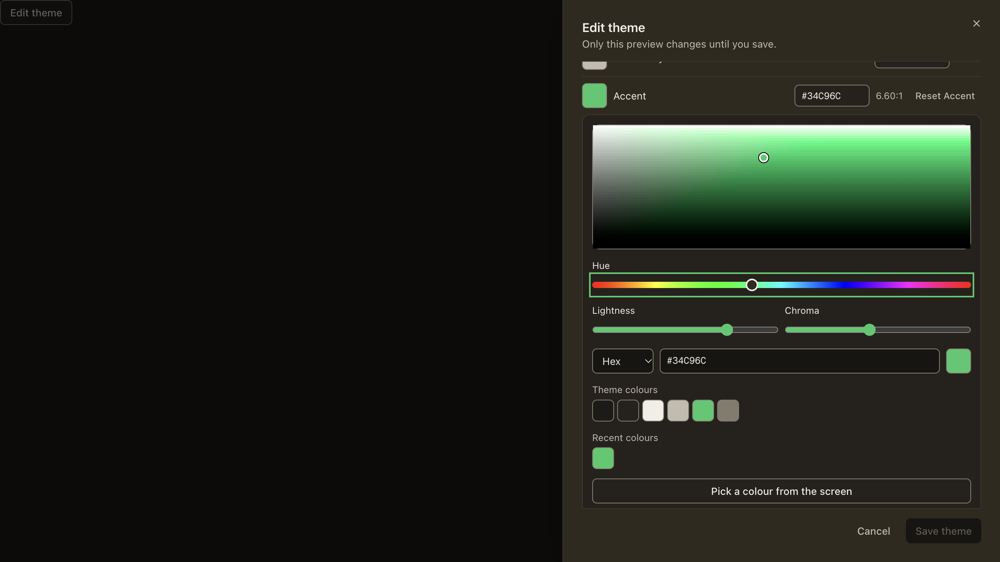
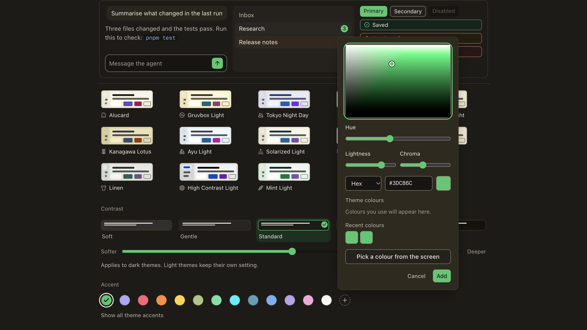
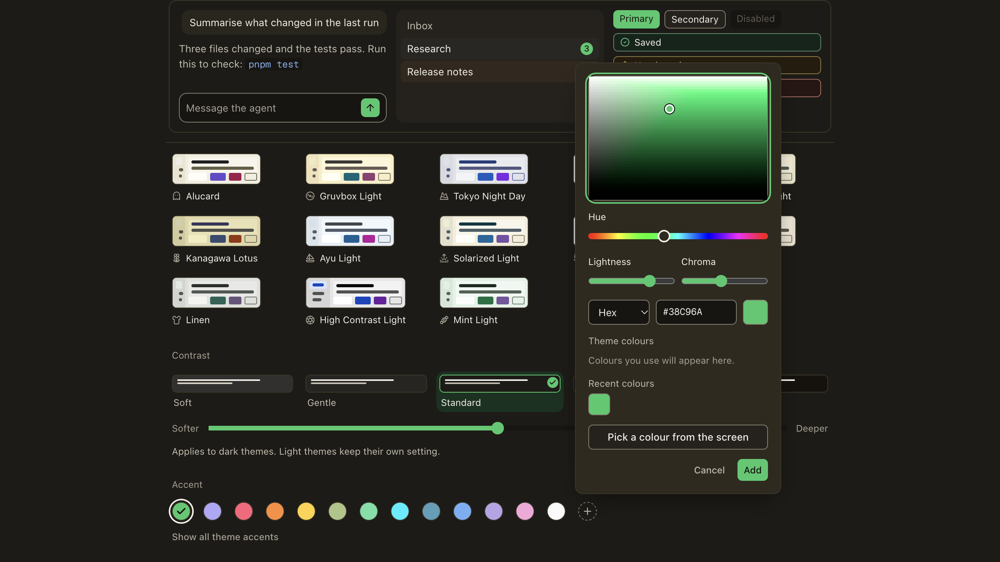
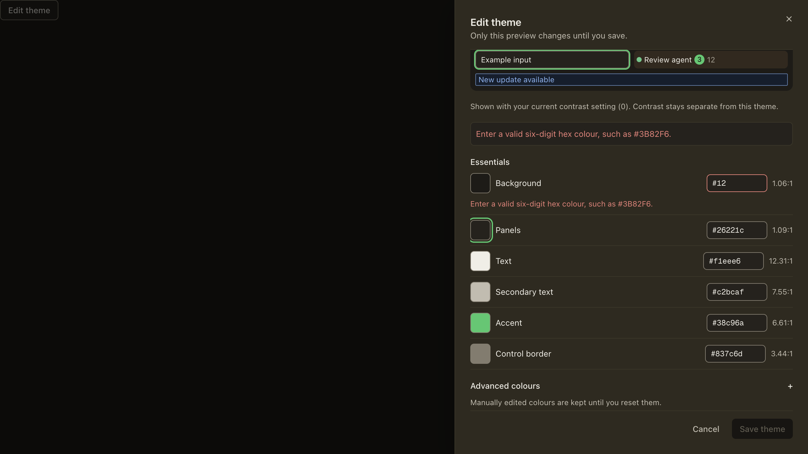

# Custom theme editor — unified round 1 remediation

PR #1687. Review scope before remediation: `bcf07606370..946d14774e7`.

## Mechanical base convergence

Rebased the same two C commits onto B `b3815971a8c` without conflicts:

```text
c3918a32800 = d71cf9a9361 feat(appearance): custom theme editor, OKLCH picker and preview
946d14774e7 = 069cf735a26 style(appearance): formatter output for the editor copy and picker
```

`git range-diff bcf07606370..946d147 b3815971a8c..069cf735a26` returned `=` for both. Ordered added/deleted lines (excluding file headers) were byte-identical: 5,736 lines on both sides; SHA256 `f9a6d26d11f46bfa5bb576bc1d9ee016aed5fb1156121360d276a4d140cb6bc5`. B's changes and the original C changes had **zero overlapping files**. This remediation subsequently adds exact entries to B's updated locale-parity exemption table; the inherited entries remain unchanged. No old code/design/QA matrix is re-certified here.

## R1 / Q1: actual paint, not just persistence

`NODE_OPTIONS=--max-old-space-size=512 node --test --test-concurrency=1 scripts/custom-theme-runtime.test.mjs scripts/custom-theme-mini-sync.test.mjs`

Actual result: **7 tests, 7 passed**, including real React provider/store/root stylesheet/MUI and a separate mini document:

```text
actual paint #32CA68 → lo-0u3dtb4; MUI #32CA68; mini lo-0u3dtb4
actual paint #30C868 → lo-0i7wu73; MUI #30C868; mini lo-0i7wu73
actual paint #31C969 → lo-1eqr4da; MUI #31C969; mini lo-1eqr4da
actual paint #31C969 → lo-1eqr4da; MUI #31C969; mini lo-1eqr4da
```

The fourth line is rehydration plus provider remount. Contrast/accent preference objects remain unchanged. These are **DOM/store tests, not native IPC/window proof**.

Negative control: the same strengthened test with only `appearance.ts` supplied from old rebased head `069cf735a26` failed both repaint assertions (expected exit 1): unchanged `lo-0bsxzgj` after an active edit, and actual root `#38c96a` instead of expected `#32CA68`. Thus the new test detects the reported bug. The old `void before` assertion omission is removed.

## R2: subscription lifetime

The actual mini entry startup/storage fragments run against synthetic lifecycle capabilities: **20 adopted appearance writes keep one library listener**, one library notification causes one repaint, and `beforeunload` removes that listener. The preferences adoption callback reuses the outer publisher instead of registering new callbacks.

## I18N-C1: exact reviewed literals

`NODE_OPTIONS=--max-old-space-size=512 node --test --test-concurrency=1 scripts/i18n/locale-parity.test.mjs`: **44/44 passed**. Added only the requested exact universal/French locale-key exceptions. The 160 English strings and seven translation maps are unchanged. Independent auditor receipts remain owned by the auditor, not this implementation.

## D1: visible spectrum, same native semantics

Before frames were captured independently by designer session `fe7553859ede` at reviewed head `946d14774e7` (PR design round 1). After frames are from the actual scoped Storybook with the original preview/theme/CSS through the harness browser. Source screenshot dimensions: 2560×1440; browser CSS viewport 1280×720.

- Editor hue input measured **485×24**, `appearance:none`; ArrowRight still changes the colour (observed hex `#34C96C`). The old editor frame edits Background, while the after frame edits Accent: compare the track treatment, not an identical selected-colour state.
- B's shared Add accent popover hue measured **230×24**, `appearance:none`. Before/after show the same retained shared flow and actual rainbow rendering; recent swatch contents differ because they are persisted fixtures.

| Surface | Before | After |
|---|---|---|
| Editor hue |  |  |
| B accent popover hue |  |  |

## D2: truthful invalid status

The real `InvalidHexBlocksSave` story play checks invalid Background `#12`, `aria-invalid=true`, Save disabled, and absence of “All contrast checks pass.” The summary now uses the existing keyed invalid-colour error (no new copy). Actual browser snapshot had two matching hex-error lines (summary + field helper), **zero** “pass” matches.



## U1: restore focus on both recovery paths

The new `DiscardRestoresEditingFocus` story play runs dirty editor → focus Edit Accent → Escape → confirmation → Escape, then repeats with **Keep editing**. Both assertions require the actual opener to regain focus. Final harness query `:focus` returned `button aria-label="Edit Accent"`. The editor ignores nested Escape while confirmation owns it so it cannot overwrite the restore target with the confirmation's own button. Discard still closes the editor and leaves its original opener restoration to the outer scope.

## Scope and cleanup

Only focused tests/affected lint, one scoped server (1450MB process-group ceiling, heap512), one reused harness browser. No dependency installs/new worktree/native build/full local suite. Final page had no console errors. Owned tab closed and wrapper signalled to reap its exact server group. Native C validation and CI remain separate manager gates; no native result is claimed here.
