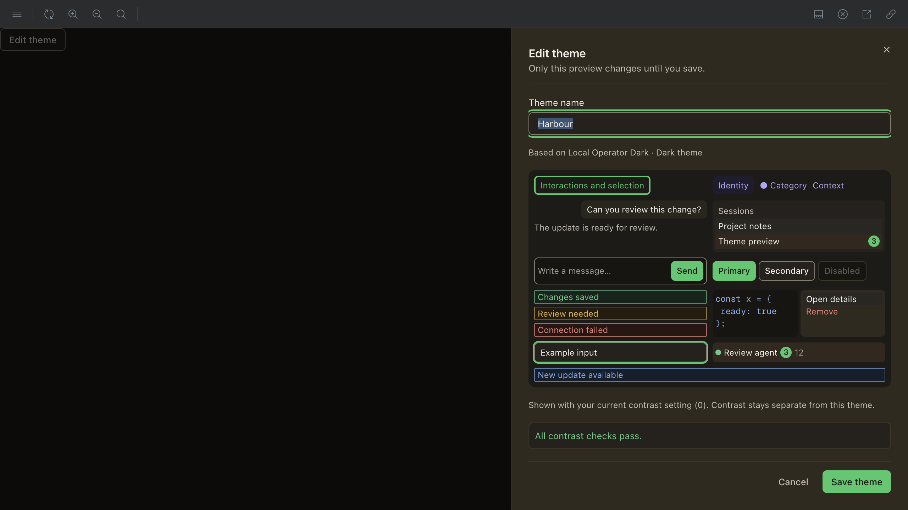
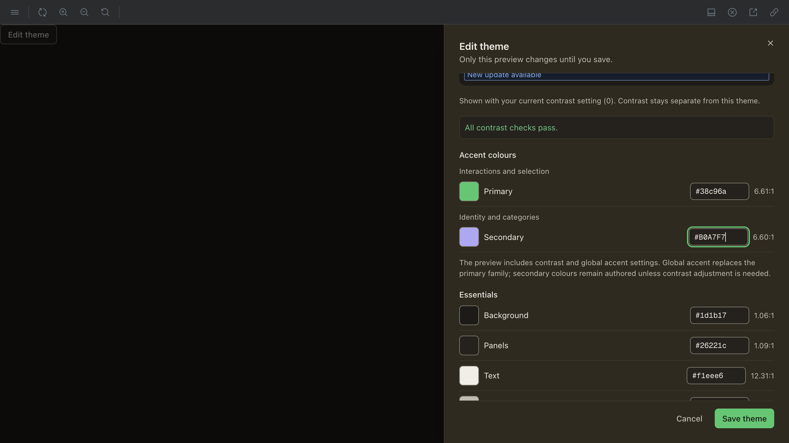
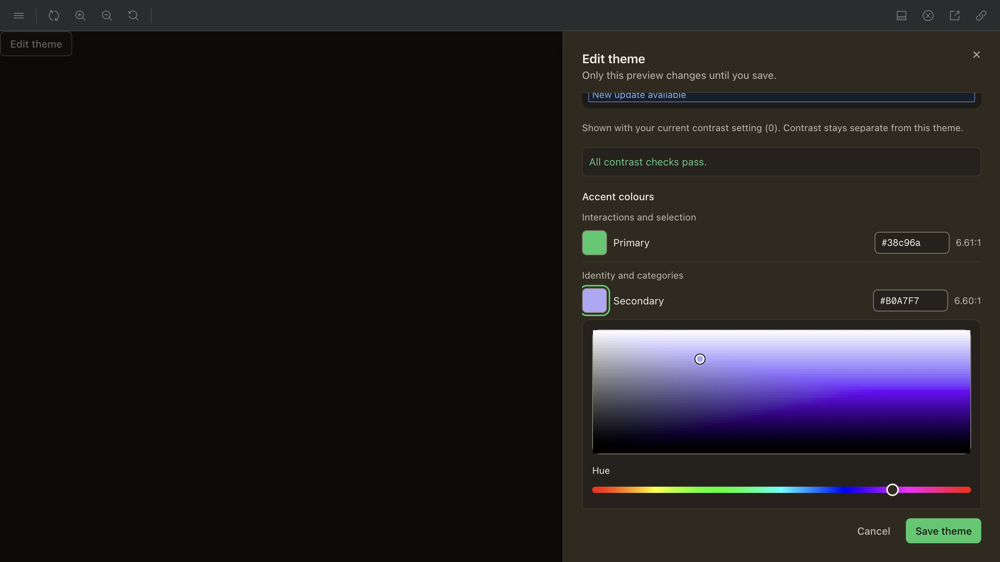
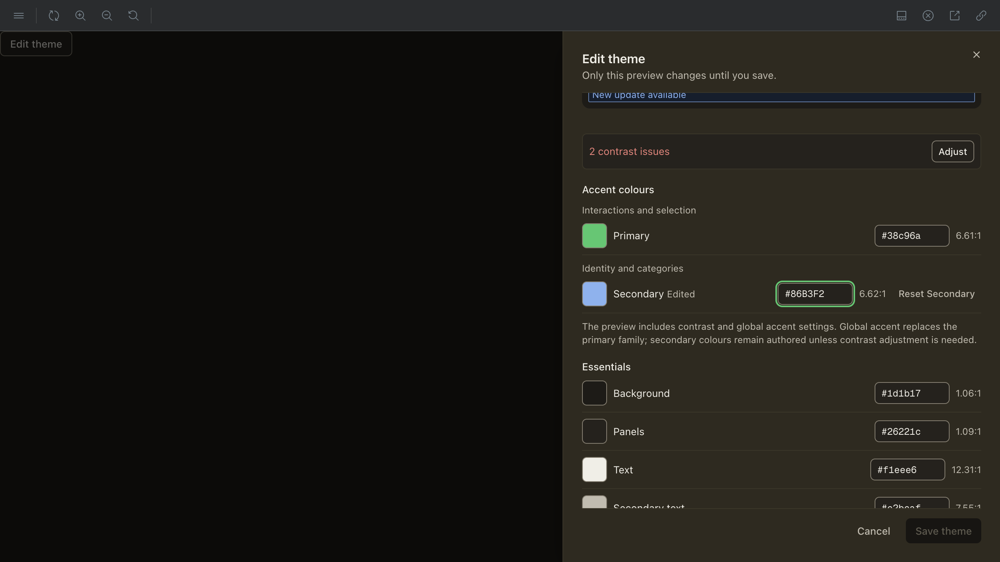
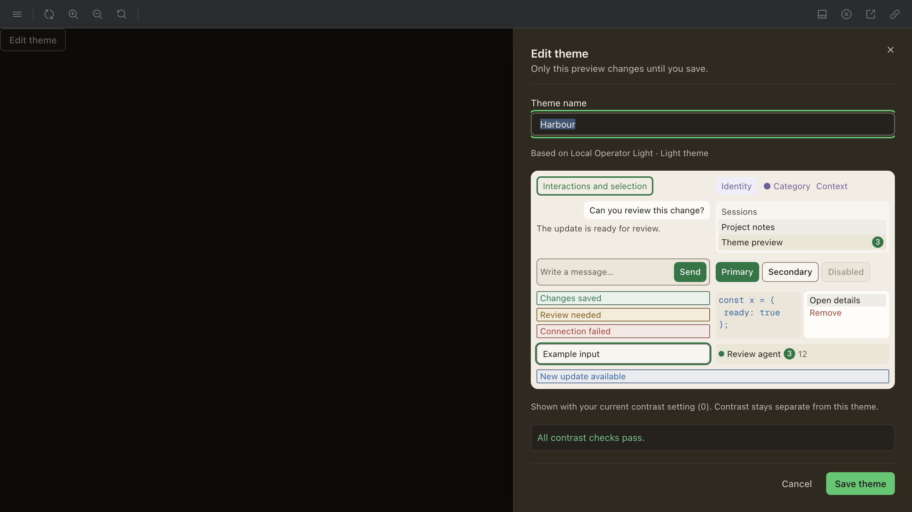
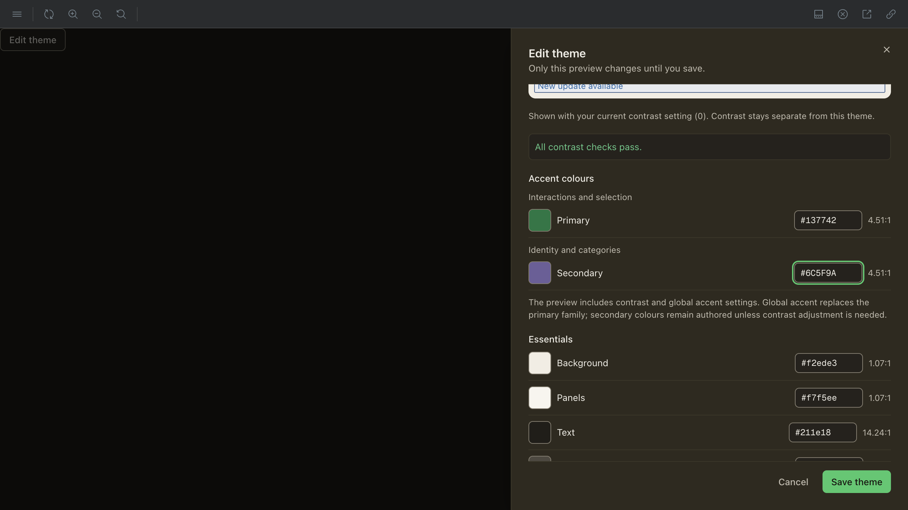

# Two meaningful accent families

Operator request: “allow for setting primary, secondary, tertiary accent colors (as many as are supported for the various themes) to create custom themes, not just one accent color”.

## Contract and constraints

All built-ins share the same supported role contract: Primary is interaction/selection (`accent`, hover, active, wash, on-ink); Secondary is identity/category ink (`accentAlt`, independent `accentAltWash`). There is no third general-purpose accent consumer and no secondary pressed/on-ink role. Status, chart and command colours are not numbered accents. MUI secondary remains the existing primary control ramp.

`accent-roles.mjs` is the DOM-free family schema. It drives root labels, storage destination, variant grouping, picker swatches, preview dispatch and the custom global-layer protection. CSS preview bindings use the existing role-to-variable mapper. Real Bridge chips use secondary ink on secondary wash; trace meta labels use secondary ink, not a secondary action button.

V1 still accepts exactly its original six seeds. Secondary edits remain sparse overrides; old files with no secondary pin inherit both values from their base. Editing secondary does not secretly derive a new wash. Independent role resets retain every other pin, including an explicitly edited companion wash.

Composition remains built-in → authored seeds/pins → mode contrast → global primary accent. For custom themes the last layer may not repaint secondary identity roles. If the existing solver cannot satisfy the contract without changing secondary, the global accent is refused and the contrasted custom theme remains effective. Built-in swap/reseat behavior is unchanged. Contrast may still adjust the effective secondary before that final layer. Saving stores authored values, never the composed preview or global preferences.

## Narrow automated evidence

Serial tests use `LOCAL_OPERATOR_UI_TEST_MEMORY_BUDGET_MB=768 LOCAL_OPERATOR_UI_TEST_CONCURRENCY=1 node scripts/run-desktop-tests.mjs` with only `scripts/custom-theme-editor.test.mjs`, `scripts/custom-theme-runtime.test.mjs` and `scripts/custom-theme-mini-sync.test.mjs`.

- Schema, legacy primary-only V1 import/export, secondary/wash sparse pins, forbidden secondary seed, semantic/primary collision validation, independent reset, contrast/global preservation and unchanged built-in swapping execute in the shared engine tests.
- Runtime tests execute the real React ThemeProvider/store/root CSS, saved selection and reload in both modes; the representative secondary preview binds `--lo-accent-alt` and `--lo-accent-alt-wash`. Existing active-ID/MUI/mini-document, quota atomicity and corrupt-storage tests remain exercised.
- Initial new runtime fixture used an invalid two-hyphen custom ID; the schema correctly refused it. Corrected to the existing lowercase alphanumeric suffix grammar, not a product/parser change. Strengthening the fixture to a non-base secondary found that dark `#B0A7F8` is outside the existing tool-row secondary/info separation exception (ΔE00 12.51 vs required 15); `#B0A7F6` and light `#6C5F99` pass. The test now paints those non-base values through the real provider and passes 7/7.
- Generated key freshness, context parity and added-copy guard are narrow localization checks. Independent translation audit supplies ledger receipts separately.

This is DOM/style-publication evidence, not native Electron or rendered-pixel proof. Full automated coverage is left to terminal CI; no native compile, dependency install, version bump or duplicate full local suite.

## Rendered comparison

Before-source: C's committed `docs/pr-evidence/custom-theme-editor-r1/after-editor-hue.png` at `149615374bfb90b2539c60b1016286c880258d5f` (inspected here; inherited frame, not recaptured). After frames below are captured here through the harness browser against the actual editor story at port 6014, same product stylesheet/fonts. The Light story edits a light custom base while the surrounding editor follows the ambient dark theme; this is not a promised paired-mode theme.

| State | Captured frame |
| --- | --- |
| Dark effective preview with secondary identity/category/meta |  |
| Promoted dark primary/secondary controls |  |
| Shared picker editing secondary |  |
| Invalid secondary equal to semantic info; 2 findings, Save disabled |  |
| Light effective preview |  |
| Promoted light primary/secondary controls |  |

Actual browser flow: dark Secondary `#B0A7F7` → valid authored `#B0A7F6` exposed `Reset Secondary`; `#86B3F2` produced **2 contrast issues** and disabled Save. Reset restored `#B0A7F7`, unchanged Primary `#38c96a`, and all checks passing. The shared secondary picker opened. Light Secondary `#6C5F9A` → `#6C5F99` left Save enabled; Save closed the editor without error. Reload persistence is proven separately by the real provider/store test, not inferred from the close.

Rig preflight found two setup defects before valid frames: an out-of-repo scoped config needed a symlink to the existing dependency tree (no install/copy), then an explicit Vite root to the actual worktree so Tailwind scanned product source. The initial unstyled frame was overwritten with the correctly styled capture; it was never accepted as visual evidence. Only one single-story server was alive at a time: initial setup PID/PGID 53267 was reaped with port closed; repaired PID/PGID 56955 was reaped with port closed after capture. Both invocations used `with-storybook.mjs` under `run_bounded.py`, a 1450 MiB inherited memory bound and 640 MiB Node heap. The one owned browser tab was closed. Cross-frame geometry reads did not resolve through the browser host, so no unmeasured layout dimensions are claimed.

## Translation provenance

Eleven new keys in `ui.settings.appearance.editor`; eight catalogues including English. Non-English text supplied by independent translator session `fd3ba80e8c8f`, served model `openai/gpt-6.1-sol`, from `multi-accent-editor.<locale>.json`. This implementer incorporated the exact maps and generated types; translation audit is independent and must name the committed bytes.
