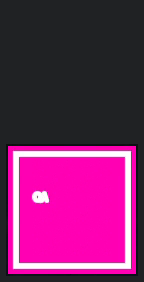

# PR #1815 — native Dock Q-VIS evidence

Evidence-only branch; **never merge this branch**. Product PR head remains `a8c1ba616c746c41929a5687c1893350f9f9f1da`.

## Observed result

On macOS arm64 / Electron 45.1.0, the real Dock tile remained stationary for the ordinary completion phase, moved for the admitted synthetic Team Bridge alert, and returned to its original position. The real native call was `app.dock.bounce("informational")`, returning ID 0. The native window was shown inactive; no activation/focus call was made. All 13 foreground samples identified the pre-existing app, never the test carrier, and the test window reported unfocused in every sample.

The same current-source bundle from the first QA run was reused (SHA-256 `81585a1f3cda89256fde2faefa1b705d2497048a95452672aa82d402216f415a`). This is a source-bundled module carrier with inert banners and real Electron Dock APIs, **not** a full renderer/IPC/native-banner test. The bright magenta QA tile is an explicitly synthetic carrier icon for unambiguous localization, not the product's shipping icon.

## Inspected frames

All four frames were opened and visually inspected by independent QA.

| Rest (1.00 s) | Ordinary alert, no movement (2.00 s) | Bridge motion peak (3.45 s) | Settled (5.20 s) |
|---|---|---|---|
|  |  |  |  |

**Privacy redaction:** these are derived native frames, not unmodified screenshots. Each retains the captured tile plus a 2-pixel border at its original position on the same fixed-coordinate 144×282-pixel canvas; surrounding desktop pixels are replaced with a neutral matte. Tile pixels and position are not reconstructed. No other app icons, wallpaper, conversations or user data are published. The original Dock-strip recording and a tile-strip clip remain local only.

## Capture and measurement

Permission was independently verified from a console surface hosted by the signed Local Operator app: `CGPreflightScreenCaptureAccess() == true`. The earlier session-launched probe had returned false. No permission prompt, setting change or app restart was performed by QA.

Dock settings: tile size 64 points; orientation/autohide preference keys unset. Measured screen `1728×1117` points, scale 2, visible-frame bottom reserve 90 points: a visible bottom Dock. Capture was restricted to the bottom 200-point strip:

```sh
screencapture -x -v -V 9 -R0,917,1728,200 <local-private-dock-strip.mov>
```

The console command launched the one inactive carrier and recorder in owned process groups, captured, and reaped before returning. The native attempt was **2 of 3**, successful without another retry. HOME/config/cwd/profile/cache were isolated, inherited CMUX/LOP variables stripped and `--use-mock-keychain` passed. Synthetic identities only; banners were inert.

The resulting clip is 9.013333 seconds, 3456×400 physical pixels, reported 120 fps. Analysis resampled to 60 Hz and localized the unique magenta tile. With a >2-pixel displacement threshold, first motion is at PTS 3.216667 s and return to rest at 4.233333 s: **1.016667 s observed motion** (16.667 ms sampling per boundary, not an exact OS timing guarantee). The peak is 138 physical pixels / 69 points above rest. The ordinary-alert analysis interval PTS 0.8–2.8 s has constant tile top 242 pixels.

Wall-clock events:

- Recorder process spawned: `2026-11-09T17:47:32.455Z`.
- Recording metadata creation time: `2026-11-09T17:47:33Z` (**whole-second precision only**).
- Ordinary alert observed: `2026-11-09T17:47:34.156Z`; inert banner shown at `34.249Z`.
- Bridge banner shown: `2026-11-09T17:47:36.156Z`; native bounce at `36.157Z`, result `{shown:true}` at `36.159Z`.
- Authority withdrawal/cancellation after recording's settled phase: `2026-11-09T17:47:41.034Z`.

Video PTS and events are aligned by recording creation metadata and the deliberately separated phases. The container creation timestamp has only second precision, so **no precise event-to-first-pixel latency is claimed**. Motion duration is measured entirely within the clip, independent of that wall-clock uncertainty.

## Cleanup and retained QA

Carrier and recorder exit 0; both exact process groups/PIDs verified absent, teardown reports `clean:true`, no survivors or reparented helpers. Console surface exited 0, was closed, and console cleanup reported zero running surfaces. Worktree HEAD remained the tested SHA throughout. No more native launches are needed.

The earlier 15 API/policy cases and 78 targeted tests are retained on this same head; they were not rerun for Q-VIS. See the PR's original QA report for that matrix. `metrics.json` contains frame hashes, event times, geometry and source identity. Only this README, four redacted tile frames and metrics are published; no product paths are changed.

Publication uses the repository's explicit `PREPUSH_BYPASS` hook path with a named reason: this unmerged, sparse evidence-only branch has no product change or dependencies, and rerunning product suites is outside this Q-VIS continuation. No tests are claimed for the evidence commit itself beyond checking its exact six-file manifest and rendering the frames.
